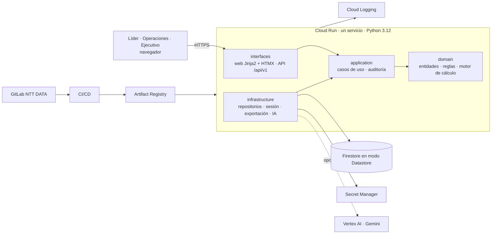
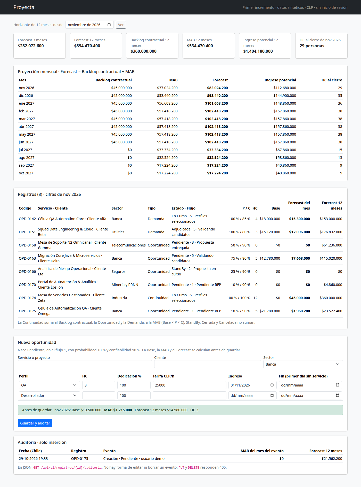
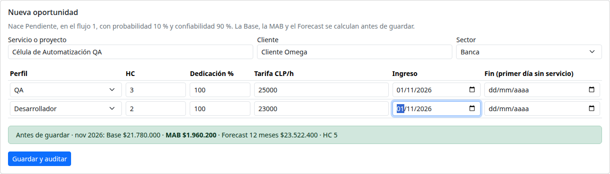

# Proyecta · Entrega 1: definición y diseño de la solución

**Build & Impact 2026 · Fundación NTT DATA Chile** · Desafío *APP Gestión de la Demanda* (Operaciones, NTT DATA GDN-e)
**Equipo:** Heavy-Duty · TEC-UCT · **Representante:** Matías Mcintire · **Product Owner:** Alfredo San Juan
**Sponsor:** Jorge Escobar, Gerente de Proyectos y responsable de Operaciones
**Fecha:** 29-10-2026 · **Rama:** `entrega-1`, con merge request a `main`

Este documento responde los 11 puntos de la Entrega 1 en el orden de las Bases (§16.1). Cada sección resume el tema y enlaza el documento del repositorio que tiene el detalle.

| # | Punto de las Bases | Sección | Detalle en el repositorio |
|:-:|---|:-:|---|
| 1 | Definición y comprensión del problema | §1 | [`requerimientos.md`](docs/fuentes/requerimientos.md) §1–§2 · [minuta](docs/fuentes/reunion_mejorada.md) · [resumen de la reunión](docs/fuentes/resumen_transcripcion_reunion.md) |
| 2 | Objetivo de la solución | §2 | [`spec.md`](specs/001-proyecta-mvp/spec.md), «Success Criteria» |
| 3 | Alcance y exclusiones | §3 | [`requerimientos.md`](docs/fuentes/requerimientos.md) §4 · [`spec.md`](specs/001-proyecta-mvp/spec.md), «Out of Scope» |
| 4 | Identificación de usuarios | §4 | [`requerimientos.md`](docs/fuentes/requerimientos.md) §5 · [`spec.md`](specs/001-proyecta-mvp/spec.md), «Actores» |
| 5 | Backlog priorizado | §5 | [`spec.md`](specs/001-proyecta-mvp/spec.md) (11 historias) · [`tasks.md`](specs/001-proyecta-mvp/tasks.md) (173 tareas) · [`equipo.md`](docs/equipo.md) |
| 6 | Arquitectura propuesta | §6 | [`plan.md`](specs/001-proyecta-mvp/plan.md) · [`research.md`](specs/001-proyecta-mvp/research.md) · [`data-model.md`](specs/001-proyecta-mvp/data-model.md) · [`openapi.yaml`](specs/001-proyecta-mvp/contracts/openapi.yaml) |
| 7 | Tecnologías seleccionadas | §7 | [`plan.md`](specs/001-proyecta-mvp/plan.md), «Technical Context» · [`pyproject.toml`](pyproject.toml) |
| 8 | Primer incremento funcional | §8 | [`src/proyecta/`](src/proyecta/) · [`tests/`](tests/) · [`deploy/Dockerfile`](deploy/Dockerfile) |
| 9 | Plan de trabajo actualizado | §9 | [`plan.md`](specs/001-proyecta-mvp/plan.md), «Milestones» · [`tasks.md`](specs/001-proyecta-mvp/tasks.md) |
| 10 | Riesgos y dependencias | §10 | [`requerimientos.md`](docs/fuentes/requerimientos.md) §14–§15 · [`plan.md`](specs/001-proyecta-mvp/plan.md), «Risks» |
| 11 | Evidencias del trabajo realizado | §11 | [`docs/entrega-1/`](docs/entrega-1/) · historial de commits |

---

## 1. Definición y comprensión del problema

**Contexto.** Operaciones de NTT DATA GDN-e Chile controla ingresos, HC y metas, y proyecta los próximos 3, 6 y 12 meses, con foco en los 3 primeros. Esa proyección depende de un pipeline que cambia cada semana:

- **oportunidades**: negocio en competencia, aún no adjudicado;
- **demandas**: negocio adjudicado, con perfiles por incorporar;
- **continuidades**: contratos vigentes que siguen facturando.

**Cómo se trabaja hoy.** El pipeline vive en una planilla Excel (`Octubre26.SemanaX.Demanda.GDN_Plantilla.xlsx`) que se actualiza y consolida a mano. Al analizarla encontramos (requerimientos §2.2):

- 101 columnas, con una grilla de 26 meses de altas, bajas y cierre cuyos encabezados no tienen año y repiten meses;
- montos calculados con 163 horas que no están escritas en ninguna celda (el desafío usa 180 h: +10,43 %);
- métricas sin fórmula reproducible (`Hot Mab`, `Ingreso Ponderado`);
- datos contradictorios: registros `Cerrada` con altas de HC, fechas inválidas (`23-07-20206`) y catálogos duplicados (`Telco` y `Telecom`; 157 clientes históricos).

**El problema.** No hay una fuente única, trazable y actualizada del pipeline, ni un criterio común para proyectar HC, ingresos, MAB y Forecast. Las consecuencias son estas:

- El Forecast no se puede defender: no se sabe de dónde sale cada cifra ni por qué cambió entre un mes y otro.
- Cada revisión ejecutiva exige horas de consolidación manual y llega desactualizada.
- La probabilidad y la confiabilidad dependen de quién las informa.
- Aparece la «plata mágica» que describió el sponsor: una venta adjudicada que todavía no está en la previsión de Invoicing desaparece de la MAB y reaparece después como facturación no planificada ([resumen de la reunión](docs/fuentes/resumen_transcripcion_reunion.md) §5.2).

**Qué cambió desde la propuesta.** La reunión con el sponsor del 15/10 y las decisiones del 27/10 ([`requerimientos.md`](docs/fuentes/requerimientos.md) §3, §4.3 y Anexo A) ajustaron la propuesta del 12/10:

| Tema | Propuesta (12/10) | Decisión vigente |
|---|---|---|
| Moneda | USD con tasa de planificación | Solo CLP |
| Estados | Pipeline de 7 estados | 6 estados, un flujo comercial de 6 etapas y un motivo de cierre |
| Probabilidad | Rangos por estado | Catálogo del Excel; 100 % fijo al adjudicar (H-01, por validar con el sponsor) |
| Horas | 180 h | 180 h como parámetro con vigencia mensual (H-04) |
| Backlog, metas y gap | No estaban | Módulo completo, prioridad 1b, a pedido de Operaciones |
| Staffing e Invoicing | Modelados como estados | Procesos externos: solo se marcan `En Staffing` y `En Invoicing` |

## 2. Objetivo de la solución

**Objetivo general.** Construir y validar, antes del Showcase del 3/12, un MVP web desplegado en GCP que sea la fuente única del pipeline de Operaciones. Debe permitir registrar, seguir, proyectar, visualizar y auditar cada oportunidad, demanda y continuidad. La Base, la MAB, el Backlog, el Forecast y el Gap se calculan con reglas explícitas y verificables, y la auditoría no se puede editar ni borrar.

**Objetivos específicos y cómo se miden** (criterios de éxito de [`spec.md`](specs/001-proyecta-mvp/spec.md)):

| Objetivo | Indicador y meta | Desde cuándo |
|---|---|---|
| Cubrir el desafío | 9 de 9 funcionalidades obligatorias del OnePage en funcionamiento | Entrega 2 (11/11) |
| Calcular sin error | 0 diferencias en los casos de referencia C-01 a C-08 en cada ejecución de pruebas | Ya se cumple (§8) |
| No contar dos veces | `Forecast = Backlog contractual + MAB` en el 100 % de los meses (SC-004) | Ya se cumple (§8) |
| Trazabilidad | El 100 % de los cambios queda auditado con valor anterior, valor nuevo e impacto en MAB y Forecast (SC-003) | Entrega 2 |
| Explicar cada cifra | Cualquier cifra del dashboard llega a sus registros en 3 interacciones o menos (SC-009) | Entrega 2 |
| Registrar rápido | Una oportunidad con dos perfiles se registra en menos de 3 minutos (SC-002) | Prueba con líderes (S4) |
| Rendimiento | El dashboard responde en menos de 2 s (p95) con 1.000 registros (SC-005) | Entrega 3 |
| Proteger los datos | 0 datos reales en la demo, las pruebas y la carga inicial (SC-012) | Siempre |
| Calidad del código | Al menos 90 % de cobertura de pruebas en el dominio (SC-010) | Entrega 3 |

## 3. Alcance y exclusiones

**Dentro del MVP** ([`requerimientos.md`](docs/fuentes/requerimientos.md) §4.1):

| Prioridad | Qué incluye | Compromiso |
|:-:|---|---|
| 1 | Las 9 funcionalidades del OnePage: registro con sus campos, bitácora, perfiles y HC, tarifas, probabilidad y confiabilidad, observaciones y fechas, mantenedor de la MAB, dashboard ejecutivo y auditoría completa. Además: inicio de sesión con tres roles, estados y flujo, y el motor de cálculo | Entrega 2 |
| 1b | Backlog (ficha de contrato), metas por sector y mes, gap y cobertura | Entrega 3 (propuesta; ver §9) |
| 2 | Calidad del dato, cierre de período con puente, exportación a Excel y asistente de coherencia con IA | Entrega 3 |
| 2b | Simulador de escenarios | Solo si hay holgura |
| 3 | Carga inicial con la estructura de la plantilla y datos sintéticos | Solo si hay holgura |

**Fuera del MVP** ([`requerimientos.md`](docs/fuentes/requerimientos.md) §4.2):

- ERP de dotación o asignación individual de consultores a proyectos.
- Costos, márgenes y contabilidad: el MVP trabaja ingresos, HC y proyección comercial.
- Integración transaccional con Invoicing, Staffing o Recruiting.
- Reemplazo del CRM: si existe, se guarda un identificador externo para conciliar.
- Inicio de sesión único corporativo, notificaciones por correo o Teams, tipo de cambio automático y BigQuery.
- Nómina, evaluación de desempeño y banco de talentos.
- Multimoneda y consolidación en USD.
- Migración de los datos reales del Excel: la demo y la carga inicial usan solo datos sintéticos (H-05).

## 4. Identificación de usuarios

| Usuario | Quién es | Qué hace en Proyecta | Qué necesita |
|---|---|---|---|
| **Líder** (rol) | Gerente o responsable de cuenta. Supuesto de diseño: 10 a 20 personas | Registra y mantiene sus oportunidades y demandas: perfiles, HC, tarifas, fechas, estado, probabilidad y bitácora | Registrar en minutos y ver el impacto de cada cambio |
| **Operaciones** (rol) | Responsable de Operaciones (el sponsor) y los administradores del área | Centraliza el seguimiento y ajusta la confiabilidad, los parámetros, los catálogos, las metas, los contratos y los cierres | Una sola vista del pipeline, los pendientes de calidad y el historial completo |
| **Ejecutivo** (rol) | Dirección y comité | Consulta dashboards y reportes y exporta; no edita | Cifras actualizadas y explicables hasta el registro |
| Staffing y Recruiting | Proceso externo | No usa la plataforma en el MVP; solo se marca `En Staffing` | — |
| Invoicing | Proceso externo | No usa la plataforma; solo se marca `En Invoicing`. Si un registro En Curso no la tiene, se genera una alerta (DQ-07) | — |
| Sponsor | Jorge Escobar | Valida las reglas, los supuestos y los criterios de aceptación | — |

La matriz completa de permisos está en [`requerimientos.md`](docs/fuentes/requerimientos.md) §5.2: el Líder edita solo sus registros, Operaciones edita todos y el Ejecutivo solo lee. La autorización se valida en el servidor, no solo en la interfaz.

**Por validar con el sponsor:** la [minuta](docs/fuentes/reunion_mejorada.md) (§3) deja pendiente confirmar quién crea, edita y cierra registros, y su primera aproximación era que solo los administradores registran. Se confirma antes de implementar los permisos (T028).

## 5. Backlog priorizado

El backlog tiene 11 historias de usuario ([`spec.md`](specs/001-proyecta-mvp/spec.md)) y 173 tareas con ruta de archivo y responsable ([`tasks.md`](specs/001-proyecta-mvp/tasks.md) y [`equipo.md`](docs/equipo.md)). El orden de ejecución es: fundación, US1, US2, US3 y US4, que forman el MVP; después, el resto por prioridad. El estado de cada fila es el de hoy, 29/10.

| Orden | Historia | Prioridad | Funcionalidades del OnePage | Tareas | Responsable | Entrega | Estado al 29/10 |
|:-:|---|:-:|:-:|:-:|---|:-:|---|
| 0 | Fundación: estructura, configuración, sesión con tres roles, CSRF, repositorios en Datastore, auditoría base y CI | Habilitante | — | T001–T036 (36) | Matías, con Nicolás, Felipe, Roberto y Bryam | E2 | **Parcial**: estructura, `pyproject.toml`, Dockerfile, app base y `/health` |
| 1 | US1 · Registrar y mantener una oportunidad o demanda | P1 | 1, 3, 4, 6 | T037–T051 (15) | Bryam, con Felipe | E2 | **Parcial**: alta de una oportunidad con dos perfiles, validación en el servidor y vista previa |
| 2 | US2 · Avanzar el ciclo de vida, el flujo y la probabilidad (incluye la bitácora) | P1 | 2, 5 | T052–T063 (12) | Felipe | E2 | Pendiente |
| 3 | US3 · Calcular y explicar la proyección | P1 | 5, 7 | T064–T079 (16) | Nicolás | E2 | **Parcial**: motor con C-01 a C-08 en verde |
| 4 | US4 · Consultar el dashboard ejecutivo | P1 | 8 | T080–T091 (12) | Leonardo | E2 | **Parcial**: serie de 12 meses y totales; faltan los 11 datos, los filtros, los gráficos y el detalle |
| 5 | US8 · Auditar cambios y controlar el acceso | P2 en la spec; su núcleo pasa a E2 porque cubre la funcionalidad 9 | 9 | T124–T133 (10) | Roberto | E2 (núcleo) | **Parcial**: evento de creación de solo inserción, consulta por registro y 405 al editar o borrar |
| 6 | US5 · Gestionar Backlog, metas y gap | P1b | Pedido de Operaciones | T092–T104 (13) | Felipe | E3 | El motor ya calcula Backlog contractual y gap (C-06 y C-07); faltan la ficha de contrato, las metas y las pantallas |
| 7 | US6 · Cerrar el período y explicar la variación | P2 | — | T105–T115 (11) | Felipe | E3 | Pendiente |
| 8 | US7 · Evaluar la calidad del dato | P2 | — | T116–T123 (8) | Bryam | E3 | Pendiente |
| 9 | US9 · Reportar y exportar | P2 | — | T134–T141 (8) | Leonardo | E3 | Pendiente |
| 10 | US10 · Asistente de coherencia con IA y simulador | P2 y 2b | — | T142–T149 (8) | Nicolás; el set etiquetado, Alfredo | E3 o con holgura | Pendiente |
| 11 | US11 · Carga inicial con datos sintéticos | P3 | — | T150–T156 (7) | Por asignar (PO) | Con holgura | Pendiente |
| 12 | Cierre: carga, accesibilidad, seguridad, documentación y demo | — | — | T157–T173 (17) | Roberto, con todo el equipo | E3 | Pendiente |

Los números de la columna «Funcionalidades del OnePage» son los de [`requerimientos.md`](docs/fuentes/requerimientos.md) §18.2. El Product Owner revisa este orden en la planificación del lunes 2/11 (línea de corte, §9).

## 6. Arquitectura propuesta

Proyecta es un **monolito modular**: un solo servicio en Cloud Run, con la interfaz renderizada en el servidor (Jinja2 + HTMX) y una API REST `/api/v1` que usa los mismos casos de uso. El código se separa en cuatro capas; el dominio no depende de FastAPI, de la base de datos ni de la nube ([`src/proyecta/README.md`](src/proyecta/README.md)).



**Decisiones principales** (justificadas en [`research.md`](specs/001-proyecta-mvp/research.md), con las alternativas descartadas):

| Decisión | Qué resuelve | Ref. |
|---|---|:-:|
| Un servicio con capas, sin separar frontend y backend | Menos piezas que desplegar; el dominio se prueba sin HTTP ni base de datos | R-01, R-02 |
| Firestore en modo Datastore detrás de un repositorio, con emulador local | Es la base de referencia de GCP (Bases §13.1); si se exige SQL, solo cambia el repositorio | R-03 |
| Sesión de servidor, Argon2id y CSRF | Permite revocar accesos y bloquear tras cinco intentos | R-04 |
| Motor de cálculo puro, con `Decimal` y montos en CLP enteros | Un solo lugar para las fórmulas, sin errores de coma flotante | R-05 |
| Auditoría y bitácora de solo inserción; versión por registro y 409 ante conflicto | Nadie puede reescribir la historia ni perder lo escrito | R-06, R-07 |
| Cierre por lotes idempotentes y proyección `ResumenMensual` | Cortes reproducibles y dashboard rápido con 5.000 registros | R-08, R-09 |
| IA opcional, detrás de una interfaz y con aprobación humana | El MVP funciona sin IA; la IA nunca escribe sola | R-11 |

El modelo de datos (17 entidades, invariantes e índices) está en [`data-model.md`](specs/001-proyecta-mvp/data-model.md), y el contrato de la API, en [`openapi.yaml`](specs/001-proyecta-mvp/contracts/openapi.yaml). Los ADR 001 a 004 están pendientes de redactar ([`docs/adr/`](docs/adr/README.md)).

**Lo que el incremento ya comprueba de esta arquitectura:**

- el motor vive en el dominio sin FastAPI ni base de datos, y se prueba solo, con 13 pruebas unitarias;
- las rutas solo traducen HTTP al dominio y no contienen fórmulas;
- la imagen Docker es la que corre en Cloud Run: escucha en `$PORT` y corre sin privilegios.

La persistencia todavía es un repositorio en memoria que ofrece las mismas operaciones que tendrá el de Datastore.

## 7. Tecnologías seleccionadas

| Capa | Tecnología | Para qué | Estado |
|---|---|---|---|
| Lenguaje y framework | Python 3.12 · FastAPI 0.162 · Uvicorn 0.54 · Pydantic v2 | Servicio web y API REST con contrato OpenAPI | **En uso** en el incremento |
| Interfaz | Jinja2 3.1 · HTMX 2.0.4 · Bootstrap 5.3.3 | Pantallas renderizadas en el servidor; vista previa sin recargar la página | **En uso** |
| Gráficos | Chart.js 4 | Dashboard ejecutivo (US4) | Planificada |
| Persistencia | Firestore en modo Datastore (`google-cloud-datastore`) y su emulador | Datos con transacciones ACID | Planificada (T018–T024) |
| Seguridad | Argon2id (`argon2-cffi`), sesión de servidor, CSRF, Secret Manager | Inicio de sesión y secretos fuera del repositorio | Planificada (T025–T027) |
| Exportación | `openpyxl` | Excel de vistas, dashboard y auditoría | Planificada (US9) |
| IA | Gemini en Vertex AI | Asistente de coherencia, opcional | Planificada (US10) |
| Pruebas y calidad | pytest 9.1 · `httpx2` (cliente de pruebas) | Pruebas unitarias y de integración | **En uso** (19 pruebas) |
| | pytest-cov · Playwright + axe-core · Ruff · mypy | Cobertura, pruebas E2E y de accesibilidad, lint y tipos | Planificadas (T003, cierre) |
| Contenedor y nube | Docker (`python:3.12-slim`) · Cloud Run · Artifact Registry · Cloud Logging | Despliegue reproducible y escalado a cero | Docker **en uso**; GCP pendiente del proyecto (S-12) |
| Código y trabajo | GitLab corporativo de NTT DATA (Bases §13.1) · merge requests | Versiones, revisión cruzada y evidencia | **En uso** |
| Especificación | Spec Kit 1.2.4 (constitución → spec → plan → tareas) | Trazabilidad desde el requisito hasta la tarea | **En uso** |

## 8. Primer incremento funcional

La propuesta comprometió para la Entrega 1 un incremento **crear → calcular → auditar**. Está en [`src/proyecta/`](src/proyecta/) y sigue las reglas de [`requerimientos.md`](docs/fuentes/requerimientos.md) v1.1. Esto es lo que hace:

1. **Crear.** Da de alta una oportunidad con hasta dos perfiles (HC, dedicación, tarifa, ingreso y fin). La oportunidad nace Pendiente, en el flujo 1, con probabilidad 10 % y confiabilidad 90 %. El servidor valida los datos y explica cada error con su regla: HC entre 1 y 999, tarifa mayor que cero, ingreso no anterior a la creación y fin posterior al ingreso.
2. **Calcular.** Antes de guardar, muestra la Base, la MAB y el Forecast mientras se escribe (HTMX), sin guardar nada. La portada muestra la serie de 12 meses (Backlog contractual, MAB, Forecast, ingreso potencial y HC al cierre) y las cifras de cada registro. Usa 7 registros sintéticos: incluyen una Continuidad, que va al Backlog contractual, y una StandBy, que no suma.
3. **Auditar.** Cada alta deja un evento con usuario, fecha y hora UTC (se muestra en hora de Chile), origen e impacto en la MAB y el Forecast. El evento se consulta en `GET /api/v1/registros/{id}/auditoria`, como dice el contrato; `PUT` y `DELETE` responden 405, porque no hay forma de editarlo ni borrarlo.





**Cómo se comprobó:**

- **19 pruebas automáticas en verde** ([salida](docs/entrega-1/evidencias/pruebas.txt)):
  - los 8 casos de referencia C-01 a C-08 de `requerimientos.md` §10.9;
  - 5 de prorrateo por días, redondeo half-up, vigencia de horas y tarifas, exclusión de StandBy, Cerrada y Cancelada, y Forecast sin doble conteo;
  - 6 del recorrido web: portada calculada con el motor, vista previa, validación, alta con auditoría y 405 al editar o borrar, texto del usuario que no se ejecuta (XSS) y `/health`.
  - Las pruebas se escribieron antes que el código, como pide la constitución (Principio V).
- **Recorrido completo en Chromium**: crear, ver la vista previa, guardar y ver el evento, sin errores en la consola. Las capturas de arriba salen de ese recorrido.
- **Imagen Docker**: se construyó con `deploy/Dockerfile` y se probó por HTTP. Corre como usuario `nobody` y escucha en `$PORT`, como pide Cloud Run.

**Cómo revisarlo:**

```bash
python3 -m venv .venv && . .venv/bin/activate
pip install -e '.[dev]'
pytest                                       # 19 pruebas
uvicorn proyecta.main:app --reload           # http://127.0.0.1:8000

docker build -f deploy/Dockerfile -t proyecta .
docker run -p 8080:8080 proyecta             # http://127.0.0.1:8080
```

**Tareas de [`tasks.md`](specs/001-proyecta-mvp/tasks.md) que adelanta** (total o parcialmente):

- Fundación: T002 a T004, T007, T010, T014 y T035.
- US1: T041 y T047 a T050.
- US3: T064, T065 y T067 a T072.

No se marcan como hechas hasta que el revisor de cada paquete lo confirme en el merge request, como pide la Definition of Done de [`equipo.md`](docs/equipo.md).

**Limitaciones que declaramos:**

- **No está desplegado en GCP:** falta el proyecto que entrega NTT DATA (S-12). La imagen está lista para Cloud Run.
- Los datos viven en memoria y se pierden al reiniciar (las Bases §13.1 permiten bases locales durante el desarrollo). Datastore entra con T018–T024.
- No hay inicio de sesión, roles ni CSRF, y los eventos usan un usuario de demostración. Entran con T025–T028.
- Solo existe el alta de oportunidades: la edición, las demandas directas, los estados, la bitácora y los contratos llegan con US1, US2 y US5.
- El motor todavía no aplica la vigencia mensual de la probabilidad y la confiabilidad (T073), el prorrateo por motivo de cierre (H-02), las altas y bajas de HC ni los ajustes (T070).
- Bootstrap y HTMX se cargan desde un CDN con verificación de integridad (SRI); T008 los servirá desde el propio servicio.

## 9. Plan de trabajo actualizado

El plan mantiene los siete sprints semanales de la propuesta y sus hitos: E1 el 28/10, E2 el 11/11, E3 el 25/11 y el Showcase el 3/12. Lo hecho y lo pendiente al 29/10:

| Sprint | Fechas | Objetivo | Resultado o criterio de salida | Estado |
|---|---|---|---|:-:|
| S1 | 13–19/10 | Entender y validar | Reunión con el sponsor el 15/10 (se movió desde el 14/10), con minuta y resumen de la transcripción | Hecho |
| S2 | 20–26/10 | Requerimientos y prototipo | Documento maestro (17/10), requerimientos internos (22/10), auditoría de requerimientos (25/10), prototipo HTML navegable (25–26/10) y prueba técnica del motor y de FastAPI + HTMX en contenedor (26/10) | Hecho, con desvíos |
| S3 | 27/10–2/11 | Especificar y primer incremento | Requerimientos oficiales v1.0 (27/10) y v1.1 (29/10); decisiones H-01 a H-07 (27/10); constitución, spec, plan, modelo de datos, contrato OpenAPI y tareas; repositorio en GitLab; incremento crear → calcular → auditar (29/10). Falta: revisar el merge request, la fundación (sesión con tres roles, emulador de Datastore, CI) y la línea de corte del 2/11 | En curso |
| S4 | 3–9/11 | Núcleo del MVP | US1 y US2 completas (registro, perfiles, estados, bitácora y auditoría por campo); vigencias de P y C en el motor; dashboard con los 11 datos y filtros; despliegue en Cloud Run; registro cronometrado con 2 líderes | Planificado |
| S5 | 10–16/11 | **Entrega 2 (11/11)**, luego Backlog | MVP con las 9 funcionalidades en una URL (fundación, US1 a US4 y el núcleo de US8), con pruebas, instrucciones, limitaciones, backlog, retroalimentación y plan de mejoras (Bases §16.2). Después: US5 (Backlog, metas y gap) | Planificado |
| S6 | 17–23/11 | Prioridad 2 y validación | Calidad del dato, cierre y puente, exportación y asistente de IA; prueba con 5 usuarios (SUS); el desarrollo termina el 23/11 | Planificado |
| S7 | 24–30/11 | **Entrega 3 (25/11)** y demo | Versión estable, documentación, declaración de uso de IA, pitch y guion de la demo; hasta el Showcase, solo ajustes menores (Bases §16.3) | Planificado |
| Cierre | 1–3/12 | **Showcase (3/12)** | Ensayos y demo en vivo | — |

**Desvíos y cómo se recuperan:**

- **Compuerta técnica del 19/10 incompleta.** Pedía un CRUD con sesión, un evento de auditoría y una prueba, desplegados. Se cumplió tarde y en parte: el incremento del 29/10 tiene alta, cálculo, auditoría y pruebas, pero no sesión ni despliegue. La sesión (T025–T028) entra en S4, y Cloud Run apenas exista el proyecto de GCP.
- **El alcance creció.** El módulo de Backlog, metas y gap (1b) no estaba en la propuesta y obliga a reestimar (S-15). Proponemos entregarlo en la E3, después del MVP.
- **El MVP es grande.** La E2 equivale a unas 101 de las 173 tareas (fundación, US1 a US4 y el núcleo de US8).

**Línea de corte del 2/11.** Se compara la velocidad real (tareas cerradas con revisión) con la planificada. Si es menor al 80 %, el MVP se entrega en versión mínima: un gráfico, filtros básicos y formularios sin edición en línea, y lo retirado pasa a S5. Las 9 funcionalidades del OnePage no se recortan.

**Ceremonias:** daily de 15 minutos los martes y jueves; los lunes, planificación, demo y retrospectiva (75 minutos); reunión con el sponsor cada 15 días (30 minutos).

Este plan es la propuesta del equipo; el Product Owner la confirma en la planificación del lunes 2/11.

## 10. Riesgos y dependencias

| Riesgo | Prob. | Impacto | Señal de alerta | Mitigación | Dueño |
|---|:-:|:-:|---|---|---|
| Sin proyecto de GCP para publicar la URL de la E2 (S-12) | Media | Alto | Sin proyecto al 2/11 | Pedirlo por escrito ahora. La imagen ya está lista para Cloud Run y el despliegue es un paso | Matías |
| Reglas sin validar por el sponsor: 180 h (S-01), 100 % al adjudicar (H-01), sexta etapa (S-02), «Cerrada» (S-03) y Anexo D sin firmas | Alta | Medio | Sin respuesta al 2/11 | Enviar por escrito los casos C-01 a C-08 y las decisiones H. Las horas y la confiabilidad son parámetros con vigencia, y las reglas están aisladas en el dominio y cubiertas por pruebas | Alfredo |
| Quién edita: la minuta lo deja abierto y la matriz permite al Líder editar lo suyo (§4) | Media | Medio | El sponsor pide que solo Operaciones edite | Confirmarlo antes de T028. El permiso se implementa en el dominio (`domain/permissions.py`) y no en las pantallas, así que cambiarlo no toca la interfaz | Alfredo y Felipe |
| Alcance mayor que la capacidad (1b nuevo; unas 101 tareas para la E2) | Alta | Alto | Velocidad bajo 80 % el 2/11 | Línea de corte (§9) y US5 después del MVP | Alfredo |
| Curva técnica de Datastore, sesión y CSRF, todavía sin probar | Media | Alto | Emulador sin integrar al 5/11 | Repositorio aislado (el incremento ya separa la persistencia) y prueba con el emulador al inicio de S4; plan B: Cloud SQL (R-03) | Matías y Nicolás |
| Código asistido por IA que el equipo no revisa (Bases §14; entregar algo «desarrollado sustancialmente por terceros» es causal de descalificación) | Media | Alto | Un merge request sin revisión, o código que su dueño no sabe explicar | [Registro de uso de IA](docs/entrega-1/REGISTRO_USO_IA.md); todo entra por merge request revisado por el dueño del paquete, con pruebas | Matías |
| Revisiones que se acumulan | Media | Medio | Un merge request sin revisar más de 48 h | Revisión en pares: Nicolás y Felipe; Leonardo y Bryam | Leonardo |
| Sin pipeline de CI: las pruebas solo corren en local | Media | Medio | Sin runner de GitLab disponible al 5/11 | Configurar el CI (T011) apenas se confirme el runner; mientras, la salida de las pruebas se adjunta al merge request | Roberto |
| Datos reales en el repositorio | Baja | Alto | Un cliente, una tarifa o un dato personal real en un commit | Solo datos sintéticos; `.gitignore` excluye Excel, CSV y la propuesta con CV; revisión en cada merge request | Roberto |
| Error de cálculo o doble conteo | Baja | Alto | Falla un caso de referencia | Motor único; C-01 a C-08 y la regla de una sola bolsa en cada ejecución de pruebas | Nicolás |
| Dependencia de una sola persona | Media | Medio | Dos semanas sin avance en un paquete | Responsables por carpeta en `equipo.md` y revisión cruzada | Alfredo |
| Falla de la demo en el Showcase | Baja | Alto | Falla el E2E en el ensayo | Datos precargados, instancia encendida, ensayos desde el 26/11 y video de respaldo | Leonardo |

| Dependencia | Qué necesitamos | Para cuándo | Plan si se atrasa |
|---|---|---|---|
| Sponsor | Validar S-01 a S-06 y H-01, confirmar quién edita, firmar el Anexo D; un usuario por rol para las pruebas de S4 y 5 para las de S6 | 2/11 (reglas); S4 y S6 (usuarios) | Las reglas quedan como parámetros; sin usuarios, se prueba con compañeros y se declara como limitación |
| NTT DATA · GCP | Proyecto con Cloud Run, Datastore, Artifact Registry, Secret Manager y Cloud Logging (S-12); orientación sobre Datastore en la sesión de Cloud (Bases §13.1) | Antes del 9/11 | Desarrollo local con contenedor y emulador; se informa como incidente según Bases §17 |
| NTT DATA · GitLab | Acceso de los 7 integrantes y un runner para el CI | 2/11 | Pruebas locales con la salida adjunta al merge request |
| Fundación | Confirmar el canal y el formato de cada entrega | Antes de la E2 | Entrega en el repositorio y aviso por correo |

## 11. Evidencias del trabajo realizado

| Fecha | Evidencia | Dónde |
|---|---|---|
| 12/10 | Propuesta técnica V3, aprobada con 96/100 | Fuera del repositorio: incluye CV con datos personales (la custodia el PO) |
| 15/10 | Reunión con el sponsor: minuta y resumen analítico de la transcripción | [`reunion_mejorada.md`](docs/fuentes/reunion_mejorada.md) · [`resumen_transcripcion_reunion.md`](docs/fuentes/resumen_transcripcion_reunion.md) |
| 17–25/10 | Documento maestro v1.3.0 y su auditoría, requerimientos internos y auditoría de requerimientos (ronda 1) | Carpeta de trabajo del equipo; las decisiones quedaron consolidadas en `requerimientos.md` |
| 25–26/10 | Prototipo HTML navegable (Bryam), revisado con 30 comprobaciones automáticas | Carpeta de trabajo del equipo |
| 26/10 | Prueba técnica: motor en Python y app FastAPI + HTMX en contenedor, base del incremento | Carpeta de trabajo del equipo |
| 27/10 | Requerimientos oficiales v1.0 (PO) y decisiones H-01 a H-07 | [`requerimientos.md`](docs/fuentes/requerimientos.md) §0.1 y Anexo A · [`spec.md`](specs/001-proyecta-mvp/spec.md), «Clarifications» |
| 27–28/10 | Constitución, especificación, plan, investigación técnica, modelo de datos, contrato OpenAPI, checklists y 173 tareas | [`constitution.md`](.specify/memory/constitution.md) · [`specs/001-proyecta-mvp/`](specs/001-proyecta-mvp/) |
| 29/10 | Requerimientos v1.1 | [`requerimientos.md`](docs/fuentes/requerimientos.md) |
| 29/10 | Primer incremento, 19 pruebas, imagen Docker y capturas | [`src/`](src/) · [`tests/`](tests/) · [`deploy/`](deploy/) · [`docs/entrega-1/evidencias/`](docs/entrega-1/evidencias/) |
| 29/10 | Registro de uso de IA (Bases §14) | [`docs/entrega-1/REGISTRO_USO_IA.md`](docs/entrega-1/REGISTRO_USO_IA.md) |
| Continuo | Historial de commits, merge requests y revisiones | Rama `entrega-1` y su merge request a `main` |

Lo que está fuera del repositorio no se versiona porque contiene datos personales o datos reales del cliente, o porque son versiones de trabajo que ya quedaron consolidadas en `requerimientos.md`. Está disponible a pedido.
