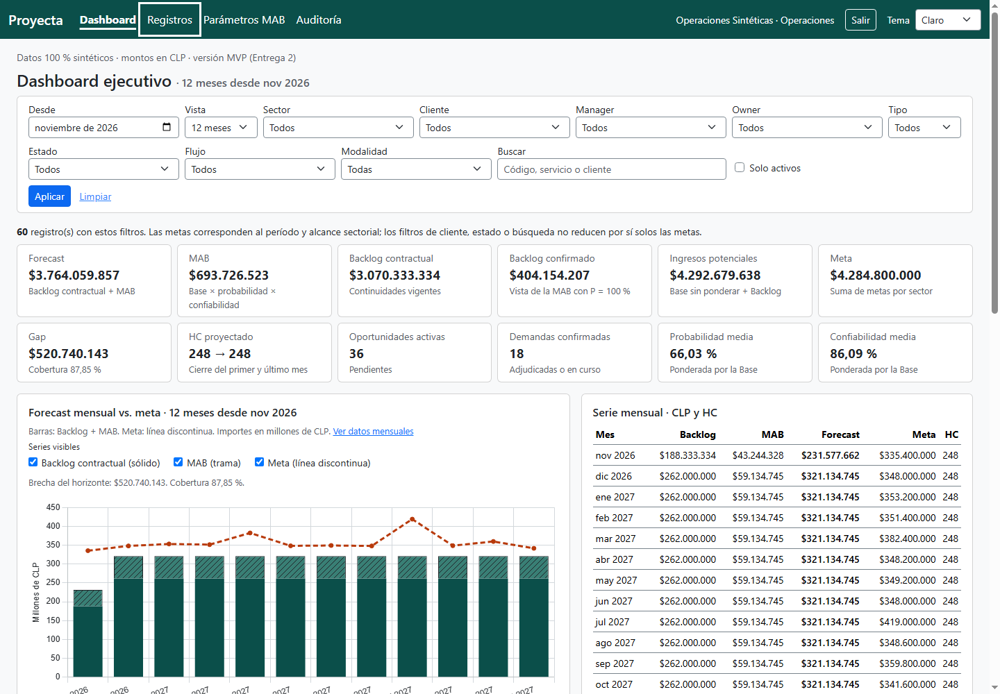
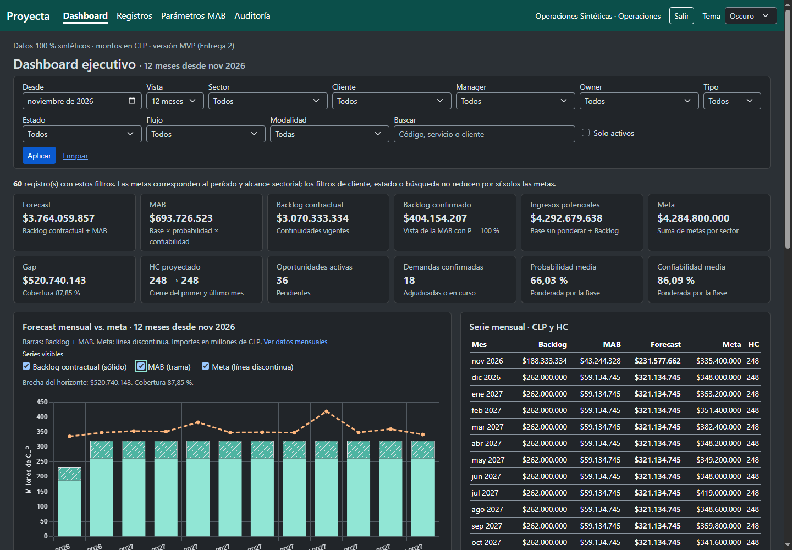
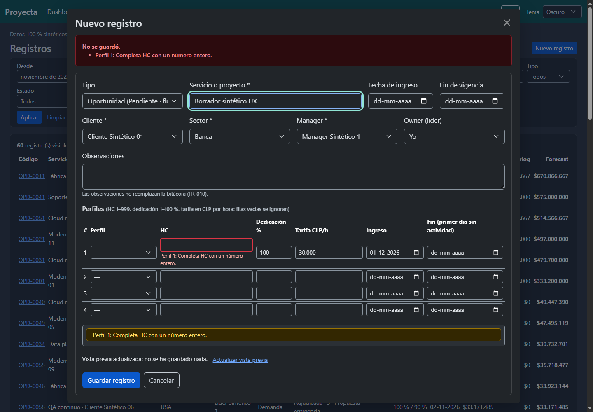

# Implementación de la auditoría: escritorio

**Fecha:** 12 de noviembre de 2026. Alcance autorizado: cambios de la auditoría que no corresponden específicamente a móvil. Se conservaron los cambios locales previos, Bootstrap, HTMX, Chart.js y las reglas del motor.

## Cambios aplicados

| Hallazgo | Resultado |
|---|---|
| H01 · Ubicación y retorno | Sección activa con subrayado, peso y `aria-current`; migas semánticas en ficha. El enlace desde el listado conserva búsqueda, período y filtros al volver, también después de guardar. El retorno solo admite el listado local. |
| H02 · Contraste y foco | Tokens compartidos para texto secundario, bordes funcionales, advertencias y foco. Foco claro en la barra verde; correcciones de errores y éxito en oscuro. |
| H05 · Gráfico | Se mantienen barras apiladas y meta. Unidades explícitas, período, resumen de brecha, MAB con trama y meta discontinua. Controles HTML de series operables con teclado, enlace a tabla y anuncios de estado. Cambio de tema conserva las series visibles y recrea el gráfico para evitar colores almacenados del tema anterior. |
| H06 · Accesibilidad general de tablas | Encabezados de clientes y pipelines; regiones de tablas con nombre y foco de teclado. No se cambió la presentación de filas para móvil. |
| H07 · Vacíos | Dashboard informa cero coincidencias y permite limpiar; explica el alcance de metas. Mensajes en cortes vacíos. Auditoría distingue ausencia de historial de filtros sin coincidencias y ofrece limpiar. |
| H08 · Formularios | Resúmenes enlazados a campos, mensajes específicos de entrada incompleta, `aria-invalid` y descripciones. Borrador restaurado únicamente en el formulario afectado, incluidos textos vacíos y checkboxes desmarcados. Conflicto de versión conserva el borrador y exige revisión explícita antes de sustituir su versión por la vigente. |
| H09 · Vista previa y envío | Estado pendiente, actualizado o fallido; aviso de cálculo anterior y reintento tras desconexión. Se calcula con el diálogo abierto, reemplazando solicitudes anteriores. Feedback al guardar y protección ante envío repetido durante la navegación. |
| H10 · Tema | Sistema/Claro/Oscuro, preferencia persistente y seguimiento del sistema. Script propio antes del pintado, compatible con CSP. Adaptación de formularios, diálogo, tablas, estados y gráfico. |
| H11 · Favicon | Símbolo vectorial de Proyecta y respaldo ICO con tamaños 16/32, servido desde la aplicación. |
| H12 · Errores web | URL de registro inválida devuelve HTML comprensible con navegación. El 404 genérico está en español; la API conserva sus respuestas JSON. |

Los valores y errores de negocio siguen siendo decididos por los casos de uso y entidades existentes. La interfaz asocia esos errores con los controles; no modifica las fórmulas, probabilidades, redondeos ni registros de auditoría.

## Pendiente por exclusión del alcance móvil

- H03: contener las tablas de historia de Parámetros para corregir el desborde a 320 px.
- H04: compactar filtros, cambiar prioridad de indicadores, accesos internos y disposición de la ficha para pantallas pequeñas.
- H06: resumen de filas para móvil, columnas fijas y ayudas específicas al gesto horizontal.
- H01/H05: señales específicas del menú móvil cerrado y adaptación de la densidad del gráfico a anchos pequeños.

Los cambios de color, tema y accesibilidad compartidos también se reflejan en otros tamaños; no se modificaron breakpoints ni se añadieron reglas de disposición móvil.

## Verificación

- Se escribieron siete pruebas HTTP de los defectos antes de implementar y se comprobó que fallaban.
- Suite completa: **97 pruebas correctas**, **93,03 % de cobertura del dominio**, sobre Python 3.12.10; se mantienen las regresiones del motor.
- Comprobación final de los formularios y navegación: **21 pruebas HTTP correctas** en `tests/integration/test_app.py`.
- Chrome headless a **1440 × 1000**: inicio de sesión, preferencia de sistema, persistencia entre páginas, cambio de tema, colores reales de las barras y trama, teclado y conservación de series, foco de menú, retorno filtrado, alta inválida y foco del error, desconexión/reintento de vista previa, estados vacíos, error HTML y carga de ambos favicon.
- Sin excepciones JavaScript en ese recorrido. Comprobación de sintaxis de JS y `git diff --check`.

| Par medido en navegador | Claro | Oscuro |
|---|---:|---:|
| Texto secundario / fondo general | 5,99:1 | 7,21:1 |
| Texto de navegación / barra verde | 9,41:1 | 9,41:1 |
| Borde de campo / fondo de campo | 3,09:1 | 4,09:1 |
| Color base MAB / tarjeta | 4,70:1 | 6,15:1 |

La comprobación mide estos pares y el color efectivo de las barras; no constituye una certificación integral de accesibilidad. Quedan fuera lectores de pantalla, pestaña visible del navegador, Safari/Firefox, móvil físico y zoom real.

Para repetir el recorrido, levantar una instancia local sintética y ejecutar `node tests/e2e/verificar_frontend.cjs`; las instrucciones y variables están en [tests/README.md](../../../tests/README.md).

## Capturas

Capturas del recorrido final de Chrome con datos sintéticos. El recuadro sobre «Registros» en la primera muestra el foco de teclado, mientras «Dashboard» mantiene la selección activa.

