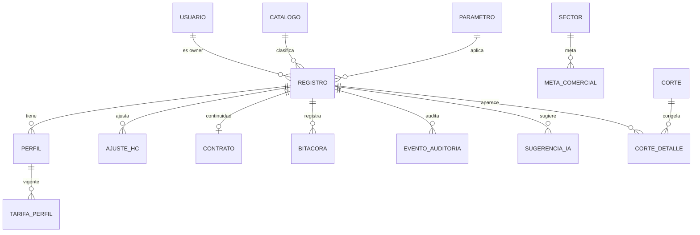
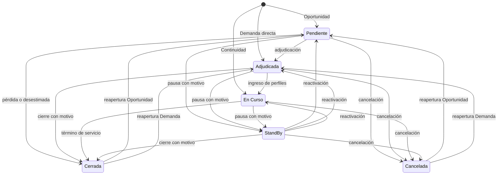
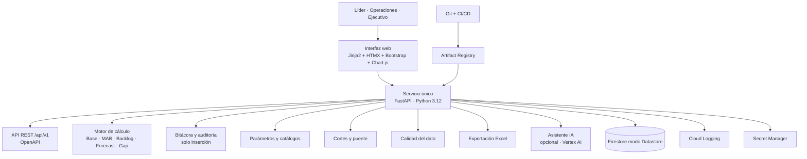

# Proyecta — Documento oficial de requerimientos

**Versión:** 1.0  
**Fecha:** 27 de octubre de 2026  
**Estado:** Para validación con el sponsor  
**Proyecto:** Proyecta — APP Gestión de la Demanda y Oportunidades  
**Iniciativa:** Build & Impact 2026 · Fundación NTT DATA Chile  
**Equipo:** Heavy-Duty · TEC-UCT  
**Product Owner:** Alfredo San Juan  
**Sponsor:** Jorge Alejandro Escobar Alvarado · Gerente de Proyectos y Responsable de Operaciones · NTT DATA GDN-e  
**Moneda:** Peso chileno (CLP)  
**Horizonte de proyección:** 12 meses móviles  
**Base de cálculo:** 180 horas mensuales por persona  

---

## 0. Control del documento

### 0.1. Historial de versiones

| Versión | Fecha | Autor | Cambio |
|---|---|---|---|
| 1.0 | 27-10-2026 | Alfredo San Juan (PO) | Consolidación de las cinco fuentes, resolución de discrepancias y definición del alcance oficial |

### 0.2. Fuentes utilizadas

| Fuente | Qué aporta | Uso en este documento |
|---|---|---|
| [Octubre26.SemanaX.Demanda.GDN_Plantilla.xlsx](Octubre26.SemanaX.Demanda.GDN_Plantilla.xlsx) | Estructura real de campos, catálogos históricos, formato CLP y lógica mensual del cliente | Verdad para campos, catálogos, formatos y datos de partida |
| [Onepage-desafio.pdf](Onepage-desafio.pdf) | Alcance del desafío, 9 funcionalidades obligatorias, 11 datos del dashboard, fórmula MAB y glosario | Verdad para alcance del MVP y definiciones del producto |
| [reunion_mejorada.md](reunion_mejorada.md) | Minuta del levantamiento: conceptos, campos, probabilidades, Staffing/Invoicing | Verdad para reglas de operación y vocabulario del negocio |
| [resumen_transcripcion_reunion.md](resumen_transcripcion_reunion.md) | Transcripción analítica: definiciones del sponsor, problemática de Invoicing y catálogos | Verdad para reglas de negocio y casuística |
| [Heavy-Duty_APPGestionDeLaDemanda_V3.pdf](Heavy-Duty_APPGestionDeLaDemanda_V3.pdf) | Propuesta técnica del equipo: arquitectura, perfiles, auditoría, calidad, IA y plan | Base de la solución propuesta y de los aportes del equipo |

### 0.3. Convenciones

- **DEBE**: requisito obligatorio para aceptar la entrega.
- **DEBERÍA**: requisito recomendado; su exclusión debe justificarse.
- **PUEDE**: funcionalidad opcional.
- Los identificadores son `RF-xx` (requerimiento funcional), `RNF-xx` (no funcional), `RN-xx` (regla de negocio), `AC-xx` (criterio de aceptación) y `D-xx` (decisión de consolidación).
- Un **mes** se identifica siempre como `YYYY-MM`; nunca por nombre suelto.
- Los montos se expresan en **CLP enteros**; las tarifas en **CLP/hora** con hasta dos decimales.
- Los porcentajes se almacenan como decimal `0,00–1,00` y se muestran como `0 %–100 %`.

---

## 1. Resumen ejecutivo

Proyecta es la aplicación web que reemplaza la gestión manual del pipeline de oportunidades y demandas de Operaciones de NTT DATA GDN-e. Su objetivo es disponer de una fuente única, trazable y actualizada para registrar, seguir, proyectar y auditar cada oportunidad, demanda y contrato de continuidad, calculando la MAB, el Backlog y el Forecast con reglas explícitas y parámetros configurables.

El problema central está descrito en el OnePage: la captura manual genera errores, inconsistencias y pérdida de trazabilidad, impide una lectura ejecutiva única y hace que el Forecast no sea defendible. La reunión con el sponsor agregó el riesgo operativo concreto: una oportunidad adjudicada que no está en Invoicing puede desaparecer de la proyección y reaparecer como facturación no planificada (la «plata mágica»).

Este documento consolida las cinco fuentes y fija las decisiones que resuelven sus discrepancias. Las principales son:

1. **Modelo híbrido**: se conservan `Tipo`, `Estado` y `Flujo` del Excel, con un catálogo de seis etapas comerciales y un registro único que no se recaptura al adjudicarse.
2. **Probabilidad**: catálogo configurable con los valores históricos del Excel, regla de 90 % por defecto para una oportunidad adjudicada y 100 % obligatorio al confirmar perfiles.
3. **Perfiles**: cada registro tiene uno o más perfiles con HC, dedicación, tarifa y fechas; la grilla mensual de altas, bajas y cierre se calcula y admite ajustes con motivo.
4. **Cálculo**: 180 horas mensuales, CLP y 12 meses móviles. Los montos del Excel, calculados implícitamente con 163 horas, se recalculan y suben 10,43 %.
5. **Dos bolsas y una vista**: Backlog contractual (continuidad) y MAB (todo el pipeline, con la demanda confirmada al 100 % de probabilidad). El Backlog confirmado es una vista de la MAB, no se suma aparte: `Forecast = Backlog contractual + MAB`, y la confiabilidad sigue aplicándose.
6. **Backlog, metas y gap**: se incorpora el módulo completo que pidió Operaciones, con ficha de contrato, meta por sector y mes, y gap automático.
7. **Controles del cliente**: se mantienen `En Staffing`, `Invoicing/Forecast` y `Studio` como indicadores independientes, auditados y visibles en el dashboard.

El alcance mantiene las 9 funcionalidades obligatorias del OnePage, agrega el módulo de Backlog/Meta/Gap y conserva como prioridad 2 la calidad del dato, el cierre con puente, la exportación y el asistente de coherencia con IA. La inclusión del módulo de Backlog amplía el alcance de la propuesta y obliga a reestimar el plan; se registra como riesgo en §15.

---

## 2. Fuentes, jerarquía de verdad y hallazgos

### 2.1. Jerarquía aplicada

| Dimensión | Fuente que manda | Razón |
|---|---|---|
| Campos, catálogos, formatos y datos existentes | Excel del cliente | Es la operación real y el contrato de datos con Operaciones |
| Alcance del MVP y fórmulas del producto | OnePage del desafío | Es la base de evaluación y el acuerdo con la Fundación |
| Reglas de operación y vocabulario | Reunión y transcripción | Explican el porqué de cada campo y cada estado |
| Aportes de solución | Propuesta Heavy-Duty | Define auditoría, calidad, perfiles, cierre y IA |
| Resolución de conflictos | Este documento | Deja una sola definición verificable |

Cuando una fuente contradice a otra, la decisión queda registrada en el **Anexo A** con su justificación. Las decisiones que el sponsor debe validar se listan en §14.

### 2.2. Hallazgos sobre el Excel

El archivo `Octubre26.SemanaX.Demanda.GDN_Plantilla.xlsx` contiene dos hojas:

- **`Demanda & Oportunidades`**: tabla `Oportunidades` con 101 columnas (A–CW) y 4 registros con datos (filas 9–12). Las columnas A–W son atributos; X–CW son 26 meses con tres columnas por mes (`Altas`, `Bajas`, `Cierre`).
- **`Resumen Oportunidades`**: tablas dinámicas y dos gráficos con conteo por sector, conteo por estado, ingresos por mes, ingresos por modalidad y una métrica llamada `Hot Mab`.

Hallazgos que condicionan el modelo:

1. **Catálogos históricos**: la caché de la tabla dinámica conserva 154 filas y valores que ya no están en la hoja: 14 sectores, 10 managers, 157 clientes, 126 tecnologías front, 4 tipos, 8 estados y 9 valores de probabilidad. Son la evidencia de los valores reales que el sistema debe admitir o normalizar.
2. **Horas implícitas**: los montos mensuales del Resumen se explican con `HC × tarifa × 163`. Por ejemplo, $847.600 = 2 × $2.600 × 163. El valor 163 no está escrito en ninguna celda; está incorporado en los valores pegados.
3. **Grilla mensual ambigua**: los encabezados `feb…dic` no tienen año y luego aparece `Ene26…Mar27`, con duplicación de ene–oct 2026. Además hay errores `Agos20-Altas`, `Oct26-Bajas2`, `Diciembre 27` y `Enero 26`.
4. **Columnas duplicadas o incompletas**: `creacion` (A) y `Creación` (S) conviven; A está vacía en los registros y tiene fechas sueltas en A108:A156. `Owner`, `ID Mana` y `En Staffing` están vacías; `Cuenta` solo tiene «No Aplica»; `Flujo` tiene un único valor; las columnas mensuales tienen altas y bajas en tres registros.
5. **Métricas no definidas**: `Hot Mab` tiene valores fijos (0; 8.802.000; 14.140.250) sin fórmula; `Ingreso Ponderado` apunta a celdas vacías y devuelve 0. No son reproducibles ni auditables.
6. **Calidad de datos**: `Estado = Cerrada` convive con 8 altas de HC; `Adjudicada` convive con probabilidad 100 %; hay fechas inválidas (`23-07-20206`, `28-06.2026`) y nombres duplicados (`Jesus Díaz`/`Jesus Diaz`, `Telco`/`Telecom`, `Si`/`Sí`).

### 2.3. Hallazgos sobre el OnePage

- Define **9 funcionalidades que deben funcionar sí o sí**: crear con campos, bitácora, perfiles/HC, tarifas, probabilidad y confiabilidad, observaciones y fechas, mantenedor de MAB, dashboard y auditoría.
- Define **11 datos críticos** del dashboard: oportunidades activas, demandas confirmadas, HC proyectado, ingresos potenciales, MAB, Forecast, probabilidad, confiabilidad, fecha de ingreso, cliente/sector y responsable.
- Fija la fórmula `Base mensual = HC × Tarifa × Horas mensuales`, con horas parametrizables y referencia aproximada de 180, y `MAB = Base × % Probabilidad × % Confiabilidad`.
- Define tres actores: Responsable de Operaciones, Líderes y Capa Ejecutiva.
- Exige auditoría de siete datos: estado, HC, tarifa, probabilidad, confiabilidad, fechas y bitácora, sin edición ni borrado.

### 2.4. Hallazgos sobre la reunión y la transcripción

- **Backlog**: proyectos o servicios contratados en períodos anteriores, con dotación asignada y facturación segura.
- **MAB**: oportunidades y demandas nuevas, ponderadas por probabilidad y confiabilidad.
- **Gap comercial**: `Meta − (Backlog + MAB)`; el ejemplo del sponsor es Meta $1.700 M, Backlog $1.000 M, MAB $500 M, Gap $200 M.
- **Probabilidades**: 10 % prospección, 25 % propuesta en elaboración con GDN-e, 50 % propuesta entregada y búsqueda de perfiles, 75 % candidatos en entrevista, 100 % perfiles seleccionados.
- **Estados**: Adjudicada, En Curso, Cancelada y StandBy.
- **Flujo**: seis etapas operativas; la transcripción nombra cinco (Pendiente RFP, Propuesta en curso, Propuesta entregada, Pendiente candidatos, Validando candidatos).
- **Staffing e Invoicing**: son procesos distintos de la adjudicación. El caso T0/T1 muestra que una venta de mitad de mes puede no estar en la previsión de Invoicing; si además se marca `Adjudicada`, desaparece de la MAB y reaparece como facturación no planificada.

### 2.5. Hallazgos sobre la propuesta

- Modelo de registro único que avanza de estado, con perfiles, tarifas con vigencia y fechas.
- Pipeline de siete estados y rangos de probabilidad por estado.
- Motor único de cálculo con casos de referencia, Forecast de 12 meses, puente entre cortes y auditoría de solo inserción.
- Tres roles, permisos por rol y por registro, API REST y dashboard.
- Aportes del equipo: puente del Forecast, asistente de coherencia con IA y simulador de escenarios (prioridad 2b).
- Ejemplos en USD y con 180 horas; este documento los reemplaza por CLP y 180 horas, según las decisiones del 27-10.

---

## 3. Decisiones de consolidación

Las siguientes decisiones son la base del documento. Cada una indica qué fuentes concilia y qué impacto tiene.

| ID | Decisión | Fundamento | Impacto |
|---|---|---|---|
| **D-01** | Modelo híbrido: `Tipo` (Oportunidad, Demanda, Continuidad) + `Estado` operativo + `Flujo` comercial de seis etapas. Un solo registro que no se recaptura al adjudicarse. | El Excel separa Tipo, Estado y Flujo; la propuesta usa un pipeline único. El híbrido conserva la operación y agrega control. | Modelo de datos con tres campos y reglas de consistencia entre ellos. |
| **D-02** | `Estado`: Pendiente, Adjudicada, En Curso, StandBy, Cerrada y Cancelada. Si es Cerrada o Cancelada, se exige `motivo_cierre`. | El Excel tiene esos estados (más Pendiente, Confirmada y SandBy); la propuesta agrega Pérdida y Desestimada como estados. Se resuelven como motivos de cierre. | Catálogo de seis estados y un catálogo de motivos; análisis de conversión por motivo. |
| **D-03** | `Flujo` de seis etapas: Pendiente RFP, Propuesta en curso, Propuesta entregada, Pendiente candidatos, Validando candidatos y Perfiles seleccionados. | La reunión pide seis etapas y nombra cinco; la sexta se toma de la propuesta y del hito del 100 %. | Etapa 6 obliga probabilidad 100 % y muestra el registro como Backlog confirmado. |
| **D-04** | Probabilidad: catálogo configurable con los valores históricos del Excel (5, 10, 12, 20, 25, 30, 50, 75 y 100 %) más 80, 90 y 95 % para el rango de Adjudicada, validada por estado y flujo. Adjudicada nace en 90 % (rango 80–95 %); 100 % obligatorio en Perfiles seleccionados. | Concilia los cinco niveles de la reunión, los nueve valores del Excel y los rangos de la propuesta. | Una sola regla verificable; se elimina el uso artificial de 100 % + En Curso. |
| **D-05** | Perfiles: uno o más por registro, con HC, dedicación, tarifa y fechas. La grilla Altas/Bajas/Cierre se calcula desde las fechas y admite ajustes con motivo. | El Excel tiene un HC y una tarifa media; la propuesta y el OnePage hablan de perfiles. El híbrido conserva la grilla sin perder el detalle. | Entidad `Perfil`, `TarifaPerfil` y `AjusteHC`; `Tarifa Media` y `HC Actual` pasan a ser calculados. |
| **D-06** | Horas mensuales: **180 h** para todo el horizonte, como parámetro único con vigencia. | Decisión del 27-10, alineada con el OnePage y la propuesta. | Los montos del Excel suben **+10,43 %** (180/163). El histórico del Excel no será comparable sin recalcular. |
| **D-07** | Moneda única **CLP** y horizonte de **12 meses móviles** con vistas de 3, 6 y 12. | El Excel está en CLP y la reunión oficializó CLP; la propuesta usaba USD solo como ejemplo. | Se elimina la multimoneda y la tasa de planificación del MVP. |
| **D-08** | Backlog: registros `Tipo = Continuidad` con ficha de contrato (inicio, fin, monto mensual comprometido, HC comprometido, renovación y aviso de término). | Decisión del 27-10: módulo completo de Backlog, Meta y Gap. | Nueva sección funcional y nuevos campos; amplía el alcance de la propuesta. |
| **D-09** | Dos bolsas y una vista: **Backlog contractual** (Continuidad) y **MAB** (todo el pipeline, incluida la demanda confirmada al 100 % de probabilidad). **Backlog confirmado** es una vista de la MAB con P=100, no una bolsa que se sume aparte. `Forecast = Backlog contractual + MAB`. La confiabilidad sigue aplicándose a la MAB. | La reunión define `Proyección = Backlog + MAB`; el OnePage exige que la confiabilidad siga siendo independiente en una demanda confirmada. | Elimina la «plata mágica» sin doble conteo y sin contradecir la fórmula del desafío. |
| **D-10** | Se mantienen `En Staffing`, `Invoicing/Forecast` y `Studio` como indicadores independientes del estado, auditados y visibles en ficha y dashboard. `Studio` es Sí/No más práctica opcional. | El Excel y la reunión los usan; la propuesta los había reemplazado por estados. | Cuatro campos adicionales y alertas de consistencia. |
| **D-11** | `Continuidad` = contrato o proyecto vigente que sigue facturando; es el Backlog operativo y no compite ni se pondera. | Decisión del 27-10 y definición de Backlog de la reunión. | `Tipo = Continuidad` exige ficha de contrato y estado En Curso. |
| **D-12** | Se retiran `Hot Mab` e `Ingreso Ponderado` como métricas del producto. Se reemplazan por MAB, Backlog y Forecast. | No tienen fórmula reproducible en el Excel y no están en el OnePage. | El dashboard no muestra métricas heredadas sin definición. |
| **D-13** | Una sola `fecha_creacion`; se conservan `Manager` (gerente de cuenta) y `Owner` (responsable del seguimiento) como campos distintos. | El Excel duplica la fecha y distingue ambos roles; la propuesta los confunde en «responsable». | Modelo más fiel y reportes por gerente y por owner. |
| **D-14** | Normalización de catálogos: sectores, managers y clientes con duplicados se unifican con una tabla de equivalencias. | Los catálogos históricos tienen duplicados (`Telco`/`Telecom`, `Jesus Díaz`/`Jesus Diaz`, `BCI`/`BCI Chile`). | Catálogos limpios y migración con alias. |
| **D-15** | La grilla de 26 meses del Excel se reemplaza por cálculo por fechas y una vista mensual de 12 meses; los meses cerrados se conservan en los cortes. | Los encabezados son ambiguos y duplican meses; el cálculo por fechas es la fuente correcta. | Menos columnas, sin errores de año y con histórico congelado por corte. |
| **D-16** | Se agregan al alcance el módulo de Backlog, las metas y el gap; se mantienen las 9 funcionalidades del OnePage y la prioridad 2 de la propuesta. | Decisiones del 27-10 y §6 del acta. | Requiere reestimar el plan de 7 semanas; se registra en §15. |
| **D-17** | El asistente de coherencia con IA se mantiene como prioridad 2 y nunca modifica datos sin aprobación humana. | Aporte de la propuesta y §8 del OnePage. | No bloquea el MVP; se puede demostrar sin IA. |
| **D-18** | El dashboard es en línea; el cierre es mensual y congela el corte. No hay cierre semanal obligatorio. | La reunión pide dashboard semanal; la propuesta define cierre de período. Un dashboard en línea cumple la necesidad semanal sin crear un proceso nuevo. | Un solo proceso de cierre mensual y consulta permanente. |

---

## 4. Alcance

### 4.1. Alcance comprometido del MVP

| Módulo | Qué incluye | Prioridad | Origen |
|---|---|---|---|
| Registro de oportunidades, demandas y continuidades | Alta, edición, cierre y consulta con todos los campos del Excel más perfiles y confiabilidad | 1 | OnePage §04; Excel |
| Perfiles, HC y tarifas | Uno o más perfiles por registro, dedicación, tarifa con vigencia y grilla mensual derivada | 1 | OnePage §04–05; propuesta §5 |
| Estados, flujo y probabilidad | Catálogo de estados, seis etapas, reglas de probabilidad y motivo de cierre | 1 | Reunión; propuesta §5; Excel |
| Motor de cálculo | Base, MAB, Backlog contractual, Forecast, vista de Backlog confirmado, ingreso potencial, HC y gap | 1 | OnePage §05; reunión §2 |
| Backlog | Ficha de contrato, monto mensual, HC comprometido, renovación y vencimientos | 1b | Decisión D-08 (nuevo) |
| Metas y gap | Meta por sector y mes, gap automático, cobertura y semáforo | 1b | Reunión §2; decisión D-08 (nuevo) |
| Dashboard ejecutivo | 11 datos del OnePage más Backlog, Meta, Gap, calidad y pipeline | 1 | OnePage §07; Excel Resumen |
| Auditoría | Evento por campo, valor anterior y nuevo, usuario, fecha, motivo, impacto en MAB y Forecast; solo inserción | 1 | OnePage §08; propuesta §5 |
| Usuarios y permisos | Tres roles, alcance por registro y por sector, control de sesión | 1 | OnePage §06; propuesta §7 |
| Bitácora | Seguimiento cronológico, próxima acción y fecha compromiso; sin edición ni borrado | 1 | OnePage §04; propuesta §5 |
| Parámetros y catálogos | Horas, confiabilidad inicial, rangos, sectores, clientes, perfiles, motivos y moneda | 1 | OnePage §05; propuesta §5 |
| Calidad del dato | Reglas, semáforo, pendientes por líder y panel de calidad | 2 | Propuesta §5.6 |
| Cierre de período y puente | Corte congelado y descomposición exacta de la variación | 2 | Propuesta §5.7 |
| Exportación | Excel de vistas, auditoría y dashboard, con filtros y permisos | 2 | Propuesta §5; OnePage |
| Asistente de coherencia con IA | Sugerencias con cita, aprobación humana y auditoría | 2 | Propuesta §5.8 |
| Simulador de escenarios | «¿Y si…?» sin guardar ni cambiar estados | 2b | Propuesta §5 |
| Carga inicial desde la plantilla | Importación de la estructura del Excel con datos sintéticos | 3 | Propuesta §5 |

**Nota de alcance:** las prioridades 1 y 1b son comprometidas. El módulo 1b (Backlog, Meta y Gap) no estaba en la propuesta original y debe incorporarse a la reestimación del plan antes de la Entrega 2.

### 4.2. Fuera de alcance del MVP

- ERP global de dotación ni asignación individual de cada consultor a proyectos (reunión §3).
- Costos, márgenes y contabilidad; el MVP trabaja ingresos, HC y proyección comercial.
- Registro contable de facturación o integración transaccional con Invoicing.
- Integración transaccional con Staffing/Recruiting; solo se registra el indicador `En Staffing`.
- Reemplazo de CRM; si existe, se guarda un identificador externo para conciliar.
- SSO corporativo, notificaciones por correo o Teams, tipo de cambio automático, API para Staffing y BigQuery (etapa posterior).
- Gestión de nómina, evaluación de desempeño o banco de talentos.
- Multimoneda y consolidación en USD.

### 4.3. Cambios respecto de la propuesta

| Tema | Propuesta original | Decisión vigente | Efecto |
|---|---|---|---|
| Moneda | Ejemplos en USD; multimoneda con tasa | CLP único | Se simplifica el motor; se elimina la tasa de planificación |
| Horas | 180 h | 180 h | Sin cambio; se recalcula el Excel desde 163 h |
| Estados | Pipeline de 7 estados | 6 estados + 6 flujos + motivo de cierre | Cambia el modelo de estados y la regla del 100 % |
| Probabilidad | Rangos duros por estado | Catálogo configurable + Adjudicada 90 + 100 en perfiles | Más flexible; requiere validación por estado |
| HC | Perfil con HC y tarifa | Perfil + grilla mensual derivada | Agrega ajustes de HC con motivo |
| Backlog | No incluido | Módulo completo | Amplía alcance y plan |
| Meta y Gap | No incluidos | Módulo completo | Amplía alcance y plan |
| Flags | No modelados | En Staffing, Invoicing y Studio | Agrega campos y alertas |
| Métricas heredadas | No las usa | Se retiran Hot Mab e Ingreso Ponderado | Se evita reproducir métricas sin fórmula |

---

## 5. Actores y permisos

### 5.1. Roles

| Rol | Descripción | Alcance |
|---|---|---|
| **Líder** | Gerente o responsable que registra y sigue sus oportunidades y demandas, informa HC, tarifa, fechas, estado y probabilidad | Solo los registros donde es `owner`; lectura de sus agregados |
| **Operaciones** | Responsable de centralizar el seguimiento, mantener el criterio común, ajustar confiabilidad, parámetros, catálogos, metas, backlog y cierres | Todos los registros y la configuración |
| **Ejecutivo** | Dirección y tomadores de decisión que consumen dashboards y reportes | Lectura de todos los registros y reportes; sin edición |

### 5.2. Matriz de permisos

| Acción | Líder | Operaciones | Ejecutivo |
|---|---|---|---|
| Crear registro | Sí | Sí | No |
| Editar registro, perfiles, fechas y estado | Solo propios | Todos | No |
| Escribir bitácora | Solo propios | Todos | Solo lectura |
| Cambiar `Tipo` y `Flujo` | Solo propios | Todos | No |
| Ajustar confiabilidad con motivo | No | Sí | No |
| Ajustar HC mensual con motivo | No | Sí | No |
| Mantener parámetros, catálogos y usuarios | No | Sí | No |
| Mantener metas comerciales | No | Sí | No |
| Mantener backlog y contratos | Solo propios | Todos | Solo lectura |
| Cerrar período y comparar cortes | No | Sí | Solo lectura |
| Ver dashboard y reportes | Propios | Todos | Todos |
| Consultar auditoría | Propios | Todos | Solo lectura |
| Exportar | Propios | Todos | Todos |
| Eliminar | No; se cierra con motivo | No; se cierra con motivo | No |

**Reglas transversales:**

- **RN-01.** Toda autorización se valida en el servidor; ocultar un botón no es control de acceso.
- **RN-02.** Un líder no puede cambiar su propio rol ni el de otra persona.
- **RN-03.** Operaciones no puede editar ni borrar eventos de auditoría ni entradas de bitácora; solo agregar.
- **RN-04.** El acceso ejecutivo es de solo lectura, incluida la exportación.

---

## 6. Glosario

| Término | Definición en Proyecta |
|---|---|
| **Oportunidad** | Negocio en competencia, aún no adjudicado. `Tipo = Oportunidad`. |
| **Demanda** | Oportunidad adjudicada que exige incorporar perfiles. `Tipo = Demanda`. |
| **Continuidad** | Contrato o proyecto vigente que sigue facturando y no compite. `Tipo = Continuidad`; constituye el Backlog contractual. |
| **Pipeline** | Conjunto de oportunidades y demandas activas, en cualquier estado no cerrado. |
| **Flujo** | Etapa comercial del registro dentro del pipeline (seis valores). |
| **Estado** | Situación operativa del registro (seis valores). |
| **Perfil** | Rol técnico requerido, con HC, dedicación, tarifa y fechas. |
| **HC / Headcount** | Cantidad de personas de un perfil. Es dato de entrada del líder; no se calcula desde costos. |
| **HC proyectado** | Personas activas por mes, calculadas desde las fechas de los perfiles y los ajustes. |
| **Tarifa** | Valor por hora de un perfil, en CLP, con fecha de vigencia. |
| **Tarifa media** | Promedio ponderado por HC de las tarifas de los perfiles de un registro; es calculada. |
| **Horas mensuales** | Parámetro de horas por persona y mes. Valor vigente: **180 h**. |
| **Base mensual** | `Σ (HC × dedicación × tarifa × horas × fracción activa)` de un registro en un mes, sin ponderar. |
| **Probabilidad (P)** | Certidumbre comercial del registro, 0–100 %. |
| **Confiabilidad (C)** | Calidad de la información disponible, 0–100 %. Solo Operaciones la ajusta, con motivo. |
| **MAB** | `Base × P × C` de los registros en pipeline ponderado. |
| **Backlog contractual** | Suma de los montos comprometidos de los registros `Tipo = Continuidad`. |
| **Backlog confirmado** | Vista de la MAB con probabilidad 100 % (perfiles seleccionados o en curso); no se suma por separado. |
| **Forecast** | `Backlog contractual + MAB` del mes. |
| **Ingreso potencial** | Base sin ponderar del pipeline más el Backlog contractual; techo teórico del mes. |
| **Meta comercial** | Objetivo de ingreso por sector y mes, en CLP. |
| **Gap comercial** | `Meta − Forecast`. Positivo: brecha por cubrir; negativo: exceso. |
| **Cobertura** | `Forecast / Meta`. |
| **Corte** | Fotografía congelada de un período para comparar y auditar. |
| **Puente** | Descomposición exacta de la variación del Forecast entre dos cortes. |
| **Staffing** | Proceso de búsqueda y asignación de personas. Se registra con el indicador `En Staffing`. |
| **Invoicing** | Aplicación corporativa de previsión de facturación. Se registra con el indicador `En Invoicing`. |
| **Studio** | Centro de práctica transversal (Data, QA, Cloud, Frontend). Se registra Sí/No y la práctica. |
| **Modalidad** | `NTT` (personal propio) o `Subcontratación` (terceros). |
| **MAB caliente / Hot Mab** | Métrica heredada del Excel, sin fórmula reproducible. **No se implementa** (D-12). |

## 7. Modelo de dominio

### 7.1. Entidades

| Entidad | Propósito | Cardinalidad |
|---|---|---|
| `Usuario` | Personas que acceden al sistema y su rol | 1:N con registros como owner |
| `Registro` | Oportunidad, demanda o continuidad; raíz del pipeline | 1:N perfiles, bitácora, auditoría y ajustes |
| `Perfil` | Rol técnico requerido dentro de un registro | N:1 con registro |
| `TarifaPerfil` | Historia de tarifas por hora de un perfil, con vigencia | N:1 con perfil |
| `AjusteHC` | Corrección manual de altas, bajas o cierre en un mes | N:1 con registro |
| `Contrato` | Ficha de contrato de un registro `Continuidad` | 1:1 con registro |
| `Bitacora` | Seguimiento cronológico e inmutable | N:1 con registro |
| `EventoAuditoria` | Cambio trazable por campo, con impacto | N:1 con registro o entidad |
| `Parametro` | Valores configurables con vigencia | N:A con el sistema |
| `Catalogo` | Sectores, clientes, managers, perfiles, tecnologías, motivos, etc. | N:A |
| `MetaComercial` | Objetivo de ingreso por sector y mes | N:1 con sector |
| `Corte` | Fotografía congelada de un período | 1:N con detalles |
| `CorteDetalle` | Valores congelados por registro y mes | N:1 con corte |
| `SugerenciaIA` | Sugerencia del asistente, con cita y aprobación | N:1 con registro |

### 7.2. Diagrama entidad-relación



### 7.3. Diccionario de `Registro`

| Campo | Tipo | Obligatorio | Regla | Origen |
|---|---|---|---|---|
| `id` | UUID | Sí | Clave primaria | Sistema |
| `codigo` | String(12) | Sí | Único, formato `OPD-0001`, secuencial | Sistema |
| `id_externo` | String(50) | No | ID Mana o CRM; único si existe | Excel J |
| `tipo` | Enum | Sí | `Oportunidad`, `Demanda`, `Continuidad` | Excel K |
| `estado` | Enum | Sí | Seis estados; coherencia con tipo y flujo (§9.2) | Excel M |
| `estado_previo` | Enum | No | Solo para `StandBy`; permite restaurar | Sistema |
| `flujo` | Enum | Sí | Seis etapas; `Perfiles seleccionados` en Continuidad | Excel O |
| `probabilidad` | Decimal(5,4) | Sí | 0–1; validada por estado y flujo | Excel L |
| `confiabilidad` | Decimal(5,4) | Sí | 0–1; inicial 90 %; solo Operaciones la cambia | OnePage §09 |
| `motivo_confiabilidad` | String(300) | Condicional | Obligatorio si cambia la confiabilidad | Propuesta §5 |
| `manager_id` | FK Catálogo | Sí | Gerente de cuenta responsable | Excel B |
| `owner_id` | FK Usuario | Sí | Líder responsable del seguimiento | Excel P |
| `sector_id` | FK Catálogo | Sí | Catálogo normalizado | Excel C |
| `cliente_id` | FK Catálogo | Sí | Catálogo con alias | Excel D |
| `servicio_proyecto` | String(200) | Sí | Nombre del servicio o proyecto | Excel E |
| `modalidad` | Enum | Sí | `NTT` o `Subcontratación` | Excel Q |
| `studio` | Boolean | Sí | Participa un Studio | Excel H |
| `studio_practica_id` | FK Catálogo | Condicional | Obligatorio si `studio = true` | Reunión §6 |
| `cuenta` | String(50) | No | Código de imputación; por defecto `No Aplica` | Excel I |
| `tecnologia_back` | Array catálogo | Sí | Al menos un valor o `No Aplica` | Excel F |
| `tecnologia_front` | Array catálogo | Sí | Al menos un valor o `No Aplica` | Excel G |
| `fecha_creacion` | Date | Sí | No futura; editable solo Operaciones con motivo | Excel S |
| `fecha_adjudicacion` | Date | Condicional | Obligatoria si `Tipo = Demanda` y estado ∈ {Adjudicada, En Curso}; también si el cierre es Término de servicio de una Demanda; ≥ creación | Excel N |
| `fecha_cancelacion` | Date | Condicional | Obligatoria si estado = Cancelada; ≥ creación | Excel N |
| `fecha_ingreso` | Date | Condicional | Obligatoria para Demanda y Continuidad; estimada para Oportunidad | Reunión §6 |
| `fecha_fin_vigencia` | Date | No | ≥ fecha_ingreso | Excel |
| `en_staffing` | Boolean | Sí | Indicador independiente; por defecto `false` | Excel T |
| `en_invoicing` | Boolean | Sí | Indicador independiente; por defecto `false` | Excel U |
| `observaciones` | Text(2000) | No | Texto libre; no reemplaza la bitácora | Excel R |
| `motivo_cierre_id` | FK Catálogo | Condicional | Obligatorio si estado ∈ {Cerrada, Cancelada} | Decisión D-02 |
| `fecha_cierre` | Date | Condicional | Obligatoria si Cerrada o Cancelada; ≥ creación | Decisión D-02 |
| `version` | Integer | Sí | Bloqueo optimista; incrementa en cada edición | Propuesta §7 |
| `creado_por`, `creado_en` | UUID, Timestamp | Sí | UTC | Sistema |
| `actualizado_por`, `actualizado_en` | UUID, Timestamp | Sí | UTC | Sistema |

### 7.4. Diccionario de `Perfil` y `TarifaPerfil`

| Campo | Tipo | Obligatorio | Regla |
|---|---|---|---|
| `perfil.id` | UUID | Sí | Clave primaria |
| `perfil.registro_id` | FK Registro | Sí | Registro padre |
| `perfil.nombre_perfil` | FK Catálogo | Sí | Catálogo de perfiles (Java, QA, DevOps, Data, etc.) |
| `perfil.hc` | Integer | Sí | ≥ 1 y ≤ 999 |
| `perfil.dedicacion_pct` | Integer | Sí | 1–100; por defecto 100 |
| `perfil.fecha_ingreso` | Date | Sí | ≥ fecha_creacion del registro, salvo migración con motivo |
| `perfil.fecha_fin` | Date | No | ≥ fecha_ingreso; nula si sigue activo; es la fecha de baja (primer día sin actividad) |
| `perfil.orden` | Integer | Sí | Orden de presentación |
| `tarifa.id` | UUID | Sí | Clave primaria |
| `tarifa.perfil_id` | FK Perfil | Sí | Perfil padre |
| `tarifa.tarifa_hora_clp` | Decimal(14,2) | Sí | > 0 |
| `tarifa.vigente_desde` | Date | Sí | Sin superposición con otra tarifa del mismo perfil |
| `tarifa.vigente_hasta` | Date | No | ≥ vigente_desde |
| `tarifa.motivo_cambio` | String(300) | Condicional | Obligatorio si reemplaza una tarifa anterior |

**Regla:** un perfil siempre tiene al menos una tarifa vigente desde su fecha de ingreso. Cambiar una tarifa no reescribe meses anteriores: agrega una nueva fila con `vigente_desde`.

### 7.5. Diccionario de `Contrato` (solo `Tipo = Continuidad`)

| Campo | Tipo | Obligatorio | Regla |
|---|---|---|---|
| `registro_id` | FK Registro | Sí | Debe ser `Tipo = Continuidad` |
| `codigo_contrato` | String(50) | Sí | Único |
| `fecha_inicio` | Date | Sí | ≤ fecha_fin |
| `fecha_fin` | Date | Condicional | Obligatoria salvo `es_indefinido = true` |
| `es_indefinido` | Boolean | Sí | Si es `true`, `fecha_fin` es nula |
| `monto_mensual_clp` | Decimal(14,0) | Condicional | ≥ 0; si es nulo, se calcula desde los perfiles |
| `hc_comprometido` | Integer | Sí | ≥ 0 |
| `renovacion_automatica` | Boolean | Sí | Por defecto `false` |
| `aviso_termino_dias` | Integer | Sí | Por defecto 90 |
| `estado_contrato` | Enum | Calculado | `Vigente`, `Por vencer`, `Vencido` |
| `observaciones` | Text(1000) | No | Texto libre |

### 7.6. Diccionario de `AjusteHC`

| Campo | Tipo | Obligatorio | Regla |
|---|---|---|---|
| `registro_id` | FK Registro | Sí | Registro afectado |
| `mes` | Date (primer día) | Sí | Mes del ajuste, `YYYY-MM` |
| `tipo` | Enum | Sí | `Alta`, `Baja`; el cierre se calcula, no se ajusta |
| `cantidad` | Integer | Sí | > 0; el signo lo determina el tipo |
| `motivo` | String(300) | Sí | Explica por qué el cálculo desde perfiles no basta |
| `usuario_id` | FK Usuario | Sí | Solo Operaciones |
| `creado_en` | Timestamp | Sí | UTC |

### 7.7. Diccionario de `Bitacora` y `EventoAuditoria`

| Campo | Tipo | Obligatorio | Regla |
|---|---|---|---|
| `bitacora.registro_id` | FK Registro | Sí | Registro padre |
| `bitacora.tipo_evento` | Enum | Sí | Seguimiento, Decisión, Reunión, Estado, Incidencia, Migración |
| `bitacora.contenido` | Text(4000) | Sí | No vacío |
| `bitacora.proxima_accion` | String(300) | No | Acción comprometida |
| `bitacora.fecha_compromiso` | Date | Condicional | Obligatoria si hay próxima acción |
| `bitacora.referencia_id` | FK Bitacora | No | Para correcciones que referencian una entrada anterior |
| `bitacora.autor_id` | FK Usuario | Sí | Autor autenticado |
| `bitacora.creado_en` | Timestamp | Sí | UTC; no editable |
| `auditoria.entidad` | Enum | Sí | Registro, Perfil, Tarifa, Contrato, Meta, Parámetro, Usuario |
| `auditoria.entidad_id` | UUID | Sí | Identificador de la entidad afectada |
| `auditoria.registro_id` | FK Registro | No | Presente cuando la entidad es del pipeline |
| `auditoria.campo` | String(60) | Sí | Campo modificado |
| `auditoria.valor_anterior` | JSON/Text | No | Valor previo serializado |
| `auditoria.valor_nuevo` | JSON/Text | No | Valor nuevo serializado |
| `auditoria.usuario_id` | FK Usuario | Sí | Autor del cambio |
| `auditoria.fecha_hora` | Timestamp | Sí | UTC; se muestra en America/Santiago |
| `auditoria.motivo` | String(300) | Condicional | Obligatorio en confiabilidad, cierre, reapertura, tarifa, HC y meta |
| `auditoria.fecha_efectiva` | Date | No | Fecha desde la cual aplica el cambio |
| `auditoria.mab_antes`, `mab_despues` | Decimal(14,0) | No | Impacto mensual en CLP |
| `auditoria.forecast_antes`, `forecast_despues` | Decimal(14,0) | No | Impacto en el horizonte |
| `auditoria.origen` | Enum | Sí | `UI`, `API`, `Carga`, `IA`, `Migración` |

**Regla:** `Bitacora` y `EventoAuditoria` son de solo inserción. La interfaz y la API no exponen `UPDATE` ni `DELETE`; una corrección genera un evento nuevo.

### 7.8. Diccionario de `Usuario`, `Parámetro`, `Catálogo`, `Meta` y `Corte`

| Entidad | Campos principales | Reglas |
|---|---|---|
| `Usuario` | id, nombre, email, rol, sectores, activo, hash, intentos_fallidos, bloqueado_hasta, último_acceso | Email único; rol único; no se autodesactiva el último Operaciones |
| `Parametro` | clave, valor, tipo, vigente_desde, vigente_hasta, usuario_id | Clave única por vigencia; sin superposición; auditado |
| `Catalogo` | tipo, codigo, etiqueta, orden, activo, metadata, padre_id | Código único por tipo; lo usado se desactiva, no se borra |
| `MetaComercial` | sector_id, mes, monto_clp, usuario_id, creado_en | Única por sector y mes; ≥ 0; auditada |
| `Corte` | fecha_corte, periodo_referencia, responsable_id, estado, version | Solo Operaciones; inmutable cuando está `Cerrado` |
| `CorteDetalle` | corte_id, registro_id, mes, bucket (`Backlog contractual` o `MAB`), base_clp, probabilidad, confiabilidad, mab_clp, backlog_clp, hc | Una fila por registro y mes; suma exacta con el Forecast |
| `SugerenciaIA` | registro_id, campo, valor_sugerido, cita_bitacora_id, estado, revisor_id, version_prompt | Nunca aplica sola; aceptar genera evento de auditoría |

### 7.9. Mapeo de la plantilla Excel al modelo

| Col. | Encabezado Excel | Campo Proyecta | Tratamiento |
|---|---|---|---|
| A | `creacion` | — | **Se descarta**; duplica S y tiene fechas sueltas fuera de la tabla |
| B | `Manager` | `manager_id` | Catálogo normalizado |
| C | `Sector` | `sector_id` | Catálogo normalizado con alias |
| D | `Cliente` | `cliente_id` | Catálogo con alias; fusiona duplicados |
| E | `Servicio/Proyecto` | `servicio_proyecto` | Texto |
| F | `Tecnología Back` | `tecnologia_back` | Multivalor; `N/A` → `No Aplica` |
| G | `Tecnología Front` | `tecnologia_front` | Multivalor; `N/A` → `No Aplica` |
| H | `Studio` | `studio` | `Si` → `true`; `No` → `false` |
| I | `Cuenta` | `cuenta` | Texto; vacío → `No Aplica` |
| J | `ID Mana` | `id_externo` | Texto opcional; sirve para conciliar con la oficina |
| K | `Tipo` | `tipo` | Normaliza `" Oportunidad"`; conserva `Continuidad` |
| L | `Probabilidad` | `probabilidad` | Formato porcentaje; valida contra catálogo |
| M | `Estado` | `estado` | Normaliza `SandBy`, `Confirmada`; ver §9.2 |
| N | `Fecha Adj / Canc.` | `fecha_adjudicacion` o `fecha_cancelacion` | Se separa según el estado; fechas inválidas se marcan |
| O | `Flujo` | `flujo` | Catálogo de seis etapas; `Pendiente Go del cliente` → `Perfiles seleccionados` |
| P | `Owner` | `owner_id` | Usuario líder |
| Q | `Modalidad` | `modalidad` | `NTT` o `Subcontratación` |
| R | `Descripción / Bitacora` | `Bitacora` | Texto legado se migra como primera entrada de tipo `Migración` |
| S | `Creación` | `fecha_creacion` | Fecha única y canónica |
| T | `En Staffing` | `en_staffing` | `Si`/`No` → booleano |
| U | `Invoicing (Demanda ForeCast)` | `en_invoicing` | `Si`/`No` → booleano |
| V | `Tarifa Media` | `TarifaPerfil` | Se usa para crear la tarifa del perfil migrado; luego es calculada |
| W | `HC Actual` | `Perfil` | Se usa como referencia; el perfil se crea con el primer cierre mayor que cero |
| X–CW | `Altas` / `Bajas` / `Cierre` (26 meses) | `AjusteHC` + cálculo por fechas | No se migran como columnas; se reconstruyen las fechas y ajustes |

**Regla de migración de la grilla mensual:** para cada registro, se crea un perfil sintético `Perfil migrado` con `HC` igual al primer cierre mayor que cero, `fecha_ingreso` igual al primer mes con alta o cierre, y una tarifa igual a `Tarifa Media`. Cada `Alta` o `Baja` posterior al mes inicial se registra como `AjusteHC` con motivo `Migración desde Excel`. El `Cierre` nunca se migra como dato: es calculado. Si un registro tiene `HC = 0` en todos los meses, se migra sin perfil y se marca para revisión.

### 7.10. Restricciones de integridad

- **RI-01.** `codigo` y `email` son únicos.
- **RI-02.** `probabilidad` y `confiabilidad` están entre 0 y 1.
- **RI-03.** `hc` es entero entre 1 y 999; `dedicacion_pct` entre 1 y 100.
- **RI-04.** `tarifa_hora_clp > 0`; `monto_mensual_clp ≥ 0`; `monto_clp ≥ 0`.
- **RI-05.** Las fechas de perfil y contrato respetan el orden inicio ≤ fin.
- **RI-06.** Un perfil no puede tener dos tarifas vigentes superpuestas.
- **RI-07.** Una meta es única por sector y mes.
- **RI-08.** Un registro `Continuidad` tiene exactamente un contrato.
- **RI-09.** Un registro `Oportunidad` o `Demanda` no tiene contrato.
- **RI-10.** `CorteDetalle` no puede existir sin `Corte` cerrado.
- **RI-11.** No se borra físicamente ningún registro, perfil, contrato, meta, corte, bitácora ni evento.

---

## 8. Catálogos y normalización

### 8.1. `Tipo`

| Código | Etiqueta | Descripción | Estado inicial |
|---|---|---|---|
| `OPORTUNIDAD` | Oportunidad | Negocio en competencia, no adjudicado | Pendiente |
| `DEMANDA` | Demanda | Negocio adjudicado que exige perfiles | Adjudicada |
| `CONTINUIDAD` | Continuidad | Contrato vigente que sigue facturando | En Curso |

### 8.2. `Estado`

| Código | Etiqueta | Definición | Bolsa | Probabilidad |
|---|---|---|---|---|
| `PENDIENTE` | Pendiente | Oportunidad abierta, aún no adjudicada | MAB | Según flujo |
| `ADJUDICADA` | Adjudicada | El cliente adjudicó; perfiles aún no confirmados | MAB | 90 % (80–95 %) o 100 % |
| `EN_CURSO` | En Curso | Perfiles incorporados y servicio en ejecución | MAB (P=100) | 100 % |
| `STANDBY` | StandBy | Detenida temporalmente por el cliente o por NTT DATA | Excluida | Congelada |
| `CERRADA` | Cerrada | Fin del ciclo; requiere motivo | Excluida | Congelada |
| `CANCELADA` | Cancelada | Cancelación formal; requiere motivo | Excluida o prorrateada | Congelada |

### 8.3. `Flujo`

| Orden | Código | Etiqueta | Estados permitidos | Probabilidad sugerida |
|---:|---|---|---|---|
| 1 | `PENDIENTE_RFP` | Pendiente RFP | Pendiente | 10 % |
| 2 | `PROPUESTA_EN_CURSO` | Propuesta en curso | Pendiente | 25 % |
| 3 | `PROPUESTA_ENTREGADA` | Propuesta entregada | Pendiente, Adjudicada | 50 % |
| 4 | `PENDIENTE_CANDIDATOS` | Pendiente candidatos | Pendiente, Adjudicada | 50 % |
| 5 | `VALIDANDO_CANDIDATOS` | Validando candidatos | Pendiente, Adjudicada | 75 % |
| 6 | `PERFILES_SELECCIONADOS` | Perfiles seleccionados | Adjudicada, En Curso | 100 % fijo |

**Reglas del flujo:**

- **RN-05.** Un registro `Pendiente` no puede estar en `Perfiles seleccionados`; primero debe pasar a `Adjudicada`.
- **RN-06.** `Perfiles seleccionados` exige al menos un perfil con HC ≥ 1 y fecha de ingreso.
- **RN-07.** Al entrar a `Perfiles seleccionados`, la probabilidad se fija en 100 % y se genera un evento de auditoría.
- **RN-08.** Si el registro retrocede desde `Perfiles seleccionados`, el líder debe informar una nueva probabilidad dentro del rango del estado; el cambio se audita.
- **RN-09.** `Continuidad` usa siempre `Perfiles seleccionados` como flujo; no recorre las etapas comerciales.

**Nota:** la probabilidad sugerida de la tabla aplica a `Pendiente`. En `Adjudicada`, los flujos 1–5 usan 90 % por defecto (rango 80–95 %) y el flujo 6 usa 100 %.

### 8.4. `Probabilidad`

| Valor | Uso típico |
|---:|---|
| 5 % | Prospección muy temprana (valor histórico del Excel) |
| 10 % | Pendiente RFP / prospección |
| 12 % | Valor histórico; se conserva por compatibilidad |
| 20 % | Valor histórico; se conserva por compatibilidad |
| 25 % | Propuesta en curso |
| 30 % | Valor histórico; se conserva por compatibilidad |
| 50 % | Propuesta entregada o pendiente de candidatos |
| 75 % | Validando candidatos |
| 80 % | Adjudicada, extremo inferior del rango |
| 90 % | Adjudicada, valor por defecto |
| 95 % | Adjudicada, extremo superior del rango |
| 100 % | Perfiles seleccionados o En Curso |

**Reglas de probabilidad:**

- **RN-10.** `Pendiente`: 5 %–75 %, obligatoriamente un valor del catálogo.
- **RN-11.** `Adjudicada` con flujo 1–5: 80 %–95 %, por defecto 90 %.
- **RN-12.** `Adjudicada` con flujo 6, `En Curso` y `Continuidad`: 100 % fijo.
- **RN-13.** `StandBy`, `Cerrada` y `Cancelada`: probabilidad congelada, no editable y fuera de la MAB.
- **RN-14.** Los valores 80, 90 y 95 % se agregan para el rango de Adjudicada; los valores 5, 12, 20 y 30 % se conservan para no romper la migración.
- **RN-15.** Operaciones puede desactivar valores del catálogo, pero no borrar los usados.

### 8.5. `Motivo de cierre`

| Código | Etiqueta | Aplica a | Efecto en el cálculo |
|---|---|---|---|
| `PERDIDA` | Pérdida | Cerrada | Sale del Forecast desde el mes de cierre |
| `DESESTIMADA` | Desestimada | Cerrada | Sale del Forecast desde el mes de cierre |
| `CANCELADA_CLIENTE` | Cancelada por el cliente | Cancelada | Prorratea hasta la fecha de cancelación y luego sale |
| `TERMINO_SERVICIO` | Término de servicio | Cerrada | Prorratea hasta la fecha de término |
| `DUPLICADO` | Duplicado | Cerrada, Cancelada | Sale del Forecast desde el mes de cierre |

### 8.6. `Sector`

Catálogo canónico y equivalencias:

| Canónico | Equivalencias históricas |
|---|---|
| Banca | Banca |
| Seguros | Seguros |
| Sector Público | Sector Público |
| Telecomunicaciones | Telco, Telecom |
| Utilities | Utilities |
| Minería y RRNN | RRNN |
| Industria | Industria |
| Salud | Salud |
| Producto | Producto |
| OffShore | OffShore |
| USA | USA |
| Interno | Proyecto Interno, Interno |

### 8.7. `Modalidad`, `Studio` y tecnologías

| Catálogo | Valores |
|---|---|
| `Modalidad` | `NTT`, `Subcontratación` |
| `Studio` | `true` / `false` |
| `Studio práctica` | Data, QA, Cloud, Frontend, Otro |
| `Tecnología` | Catálogo configurable; se siembra con los valores más usados del Excel: Java, Angular, React, .NET, Oracle, Python, AWS, Azure, GCP, DevOps, Data, QA, Mobile, Salesforce, OutSystems, BI, SQL Server, No Aplica |
| `Perfil` | Catálogo configurable; se siembra con: Desarrollador, Desarrollador Senior, QA, QA Automation, DevOps, Data Engineer, Arquitecto, Analista, Soporte, Líder Técnico, Otro |

**Reglas de tecnología:**

- **RN-16.** `tecnologia_back` y `tecnologia_front` son multivalor y no pueden quedar vacíos: si no aplica, se registra explícitamente `No Aplica`.
- **RN-17.** Un valor `No Aplica` no puede convivir con otras tecnologías en el mismo campo.
- **RN-18.** El catálogo de tecnologías se normaliza: se unifican espacios, mayúsculas y alias (`React ` → `React`, `ReactNativ` → `React Native`, `OracleForm` → `Oracle Forms`).

### 8.8. Normalización de valores heredados

| Campo | Valor heredado | Valor canónico | Acción |
|---|---|---|---|
| Tipo | `" Oportunidad"` (espacio inicial) | `Oportunidad` | Recorte y normalización |
| Tipo | `Demanda`, `Continuidad` | Igual | Sin cambio |
| Estado | `SandBy` | `StandBy` | Corrección de grafía |
| Estado | `Confirmada` | `Adjudicada` | Mapeo; se registra en migración |
| Estado | `Pendiente` | `Pendiente` | Sin cambio |
| Estado | `Cerrada`, `Cancelada`, `Adjudicada`, `En Curso` | Igual | Sin cambio |
| Flujo | `Pendiente Go del cliente` | `Perfiles seleccionados` | Mapeo; validar con el sponsor |
| Probabilidad | `1` | `100 %` | Formato |
| Sector | `Telco`, `Telecom` | `Telecomunicaciones` | Alias |
| Sector | `RRNN` | `Minería y RRNN` | Alias |
| Sector | `Proyecto Interno`, `Interno` | `Interno` | Alias |
| Manager | `Jesus Diaz` | `Jesús Díaz` | Alias |
| Manager | `Carlos Moller` | `Carlos Moller` | Se conserva; validar grafía con el sponsor |
| Manager | `Pendiente` | Sin asignar | Se exige asignación antes de guardar |
| Cliente | `BCI`, `BCI Chile` | `BCI` | Alias |
| Cliente | `Santander`, `Santander Chile` | `Santander Chile` | Alias |
| Cliente | Espacios iniciales/finales | Recorte | Limpieza |
| Studio | `Si` | `Sí` / `true` | Normalización |
| Fecha | `23-07-20206` | Fecha válida o nula | Marcar para revisión |
| Fecha | `28-06.2026` | `28-06-2026` | Corrección de separador |

## 9. Reglas de negocio

### 9.1. Ciclo de vida y transiciones



| Transición | Quién | Condiciones | Efectos |
|---|---|---|---|
| Nueva oportunidad → Pendiente | Líder | Tipo Oportunidad | Flujo 1; P 10 %; C 90 % |
| Nueva demanda directa → Adjudicada | Líder | Tipo Demanda y motivo «Demanda directa» | Flujo 3–5; P 90 %; fecha_adjudicacion |
| Nueva continuidad → En Curso | Operaciones | Tipo Continuidad y ficha de contrato | Flujo 6; P 100 %; C 100 % |
| Pendiente → Adjudicada | Líder | Fecha de adjudicación; al menos un perfil | Tipo pasa a Demanda; P 90 %; auditoría |
| Adjudicada → En Curso | Líder | Perfiles con fecha de ingreso; P 100 % | Queda al 100 % y pasa a la vista de Backlog confirmado; auditoría |
| Cualquiera → StandBy | Líder u Operaciones | Motivo obligatorio | Guarda `estado_previo`; sale del cálculo |
| Cualquiera → Cerrada | Líder u Operaciones | Motivo de cierre y fecha | Sale del cálculo desde el mes de cierre |
| Cualquiera → Cancelada | Líder u Operaciones | Motivo y fecha de cancelación | Prorratea hasta la fecha y sale |
| StandBy → estado previo | Líder u Operaciones | Motivo de reactivación | Restaura estado, P y C previos |
| Cerrada/Cancelada → Pendiente o Adjudicada | Operaciones | Motivo de reapertura; Oportunidad vuelve a Pendiente y Demanda a Adjudicada | Vuelve al pipeline; auditoría |

**Reglas de transición:**

- **RN-19.** No se permite `Pendiente → En Curso` sin pasar por `Adjudicada`.
- **RN-20.** `Cerrada` y `Cancelada` son estados terminales; solo Operaciones puede reabrir con motivo.
- **RN-21.** Toda transición exige fecha efectiva y genera un evento de auditoría con estado anterior y nuevo.
- **RN-22.** Si el registro estaba en `Perfiles seleccionados` y retrocede, la probabilidad se reingresa y se audita.
- **RN-23.** `Continuidad` no puede estar en `Pendiente` ni en `Adjudicada`.

### 9.2. Coherencia entre tipo, estado y flujo

| Tipo | Estados permitidos | Flujos permitidos |
|---|---|---|
| Oportunidad | Pendiente, StandBy, Cerrada, Cancelada | 1–5 en Pendiente |
| Demanda | Adjudicada, En Curso, StandBy, Cerrada, Cancelada | 1–5 en Adjudicada (MAB); 6 en Adjudicada o En Curso |
| Continuidad | En Curso, StandBy, Cerrada, Cancelada | 6 |

**Nota:** una oportunidad que se adjudica cambia a `Demanda` en la misma transacción (RN-24); por eso `Adjudicada` y `En Curso` no se persisten como `Oportunidad`.

**Reglas:**

- **RN-24.** Al pasar a `Adjudicada`, el `Tipo` cambia automáticamente a `Demanda`; solo Operaciones puede revertirlo con motivo.
- **RN-25.** Un registro `Demanda` no puede volver a `Pendiente`; la reapertura de Operaciones lo devuelve a `Adjudicada`.
- **RN-26.** `Perfiles seleccionados` solo es válido en `Adjudicada` o `En Curso`.
- **RN-27.** Un registro `Continuidad` no recorre el flujo comercial; su flujo es fijo `Perfiles seleccionados`.
- **RN-28.** Si el cliente rechaza un perfil, el registro vuelve de `Perfiles seleccionados` a `Adjudicada` o `Validando candidatos` con motivo y nueva probabilidad.

### 9.3. Probabilidad y confiabilidad

**Probabilidad:**

- **RN-29.** En `Pendiente`, la probabilidad por defecto se asigna según el flujo: 10 %, 25 %, 50 %, 50 % y 75 % para las etapas 1 a 5. La etapa 6 no es válida en `Pendiente`.
- **RN-30.** En `Adjudicada` con flujo 1–5, el valor por defecto es 90 % y el rango permitido es 80 %–95 %.
- **RN-31.** En `Perfiles seleccionados`, `En Curso` y `Continuidad`, la probabilidad es 100 % y no es editable.
- **RN-32.** El líder puede ajustar la probabilidad dentro del rango del estado; el cambio se audita con valor anterior y nuevo.
- **RN-33.** Operaciones puede cambiar la probabilidad de cualquier registro con motivo.
- **RN-34.** La probabilidad de un registro en `StandBy`, `Cerrada` o `Cancelada` queda congelada y no se usa en el cálculo.

**Confiabilidad:**

- **RN-35.** Nace en 90 % para todo registro nuevo, salvo `Continuidad`, que nace en 100 %.
- **RN-36.** Solo Operaciones puede modificarla, entre 0 % y 100 %, con motivo obligatorio y fecha efectiva.
- **RN-37.** El cambio aplica desde el mes de la fecha efectiva; no reescribe meses anteriores.
- **RN-38.** La confiabilidad no se aplica al Backlog contractual, que usa 100 %; sí se aplica a la MAB, incluida la vista de Backlog confirmado.
- **RN-39.** El dashboard muestra el promedio de confiabilidad ponderado por base y su distribución por tramos.

### 9.4. Perfiles, HC y tarifas

- **RN-40.** Todo registro que pase a `Adjudicada`, `Perfiles seleccionados` o `En Curso` debe tener al menos un perfil con HC ≥ 1. Un registro `Pendiente` puede existir sin perfil y se reporta como incompleto.
- **RN-41.** `Continuidad` exige `hc_comprometido` ≥ 0 y puede tener perfiles detallados; si no los tiene, el HC comprometido es la fuente.
- **RN-42.** El HC es un entero positivo por perfil; la suma de HC del registro es el HC del registro.
- **RN-43.** La dedicación es 100 % por defecto y puede ser parcial (1 %–100 %) por perfil.
- **RN-44.** Cada perfil tiene al menos una tarifa vigente; una tarifa nueva se agrega con fecha de vigencia y no reescribe el pasado.
- **RN-45.** La tarifa media del registro es `Σ(HC × tarifa) / Σ(HC)` y es calculada, no editable.
- **RN-46.** El HC actual es la suma de HC de perfiles activos en la fecha de consulta y es calculado.
- **RN-47.** La grilla mensual se calcula así:
  - `Altas(r,m) = Σ HC de perfiles con fecha_ingreso en m + ajustes de alta en m`.
  - `Bajas(r,m) = Σ HC de perfiles con fecha_fin en m + ajustes de baja en m`.
  - `Cierre(r,m) = Cierre(r,m−1) + Altas(r,m) − Bajas(r,m)`.
  - El primer mes del registro parte con cierre 0.
- **RN-48.** El cierre no puede ser negativo; si el cálculo lo produce, se bloquea el guardado y se pide corregir perfiles o ajustes.
- **RN-49.** Un ajuste de HC requiere motivo, mes y usuario de Operaciones; se audita y se muestra en la grilla con una marca.
- **RN-50.** El HC proyectado es la dotación al cierre de cada mes; el prorrateo por días aplica solo a los montos. Un perfil con baja en el mes no suma al cierre de ese mes, pero sí genera el monto de los días trabajados.
- **RN-51.** El HC se agrupa por grado de certeza: confirmado (Continuidad y En Curso), por confirmar (Adjudicada con flujo 1–5) y oportunidad (Pendiente).

### 9.5. Fechas y vigencias

- **RN-52.** `fecha_creacion` no puede ser futura; para registros nuevos, `fecha_ingreso ≥ fecha_creacion`.
- **RN-53.** `fecha_adjudicacion`, `fecha_cancelacion` y `fecha_cierre` deben ser ≥ `fecha_creacion`.
- **RN-54.** `fecha_fin_vigencia ≥ fecha_ingreso`.
- **RN-55.** Las fechas de perfil deben estar dentro de la vigencia del registro; una excepción requiere motivo de Operaciones.
- **RN-56.** Las tarifas no se superponen para un mismo perfil.
- **RN-57.** Las fechas de negocio son `DATE` sin hora; los eventos son `TIMESTAMP` en UTC y se muestran en America/Santiago.
- **RN-58.** Un mes se identifica como `YYYY-MM`; el sistema usa el primer día del mes para comparar y agrupar.

### 9.6. Backlog

- **RN-59.** Solo un registro `Continuidad` puede tener contrato.
- **RN-60.** El contrato exige código, inicio, fin (o `es_indefinido`), monto mensual o perfiles, y HC comprometido.
- **RN-61.** `Backlog contractual(r,m) = monto_mensual × fracción_activa_del_contrato(m)`; si el monto es nulo, se usa la base de los perfiles al 100 %.
- **RN-62.** El Backlog no se pondera: P = 100 % y C = 100 %.
- **RN-63.** El Backlog no se suma a la MAB; se suma al Forecast en una línea separada.
- **RN-64.** El contrato se clasifica como `Vigente`, `Por vencer` (dentro de `aviso_termino_dias`) o `Vencido`.
- **RN-65.** Los vencimientos generan alertas a 90, 60 y 30 días; la renovación automática es informativa y no extiende fechas sin confirmación de Operaciones.
- **RN-66.** Un contrato vencido sin cierre genera alerta roja y deja de sumar Backlog desde el mes siguiente al vencimiento.

### 9.7. Calidad del dato

| ID | Regla | Severidad | Responsable | Acción |
|---|---|---|---|---|
| `DQ-01` | Campos obligatorios incompletos | Rojo | Líder | Bloquea el guardado |
| `DQ-02` | Registro sin actualización por más de 14 días | Amarillo | Líder | Aparece en pendientes |
| `DQ-03` | Ingreso a 30 días o menos sin `Perfiles seleccionados` | Rojo | Líder | Alerta en ficha y dashboard |
| `DQ-04` | Oportunidad sin próxima acción | Amarillo | Líder | Aparece en pendientes |
| `DQ-05` | Probabilidad fuera del rango del estado | Rojo | Líder | Bloquea el guardado |
| `DQ-06` | Adjudicada sin `En Staffing` | Amarillo | Líder | Alerta de staffing |
| `DQ-07` | En Curso sin `Invoicing` | Rojo | Operaciones | Alerta de «plata mágica» |
| `DQ-08` | Continuidad sin fin de contrato o sin monto | Rojo | Operaciones | Bloquea el cierre del registro |
| `DQ-09` | Perfil sin tarifa o tarifa ≤ 0 | Rojo | Líder | Bloquea el guardado |
| `DQ-10` | Fechas de perfil fuera de la vigencia del registro | Rojo | Líder | Bloquea el guardado |
| `DQ-11` | Contrato con fin anterior al inicio | Rojo | Operaciones | Bloquea el guardado |
| `DQ-12` | Sector/mes sin meta cargada | Amarillo | Operaciones | Alerta en el gap |
| `DQ-13` | Cliente o manager duplicado | Informativo | Operaciones | Sugerencia de fusión |

**Reglas:**

- **RN-67.** El semáforo de un registro es rojo si tiene al menos una regla roja, amarillo si tiene solo amarillas y verde si no tiene hallazgos.
- **RN-68.** El líder ve solo los pendientes de sus registros; Operaciones ve todos.
- **RN-69.** Las reglas de calidad no reemplazan la validación de campos: son una capa adicional de seguimiento.

### 9.8. Cierre de período y puente

- **RN-70.** El cierre es mensual y lo ejecuta Operaciones.
- **RN-71.** Un corte congela, por registro y mes, la base, la probabilidad, la confiabilidad, la MAB, el Backlog y el HC.
- **RN-72.** Un corte cerrado es inmutable; una corrección genera una nueva versión del corte.
- **RN-73.** El puente compara dos cortes del mismo mes y descompone la variación en: registros nuevos, registros cerrados, efecto base (HC, tarifa o fechas), efecto probabilidad, efecto confiabilidad, efecto parámetros (horas), efecto Backlog y efecto horizonte.
- **RN-74.** La suma de las categorías del puente debe igualar la variación total; la diferencia de redondeo se muestra en una línea separada.
- **RN-75.** El cierre no bloquea la edición del pipeline; el siguiente corte refleja los cambios.

### 9.9. Auditoría, bitácora y concurrencia

**Datos auditados:**

| Dato | Motivo obligatorio | Impacto calculado |
|---|---|---|
| Estado, tipo y flujo | Sí | MAB y Forecast |
| HC y perfiles | Sí | Base, MAB, Forecast y HC |
| Tarifa y vigencia | Sí | Base, MAB y Forecast |
| Probabilidad | Sí | MAB y Forecast |
| Confiabilidad | Sí | MAB y Forecast |
| Fechas de ingreso, adjudicación, cancelación y cierre | Sí | Base, MAB, Forecast y HC |
| Monto y fechas del contrato | Sí | Backlog y Forecast |
| Meta comercial | Sí | Gap y cobertura |
| Parámetros (horas, confiabilidad inicial, umbrales) | Sí | Todo el motor |
| Usuarios, roles y permisos | Sí | Acceso |
| Entradas de bitácora | No | Ninguno |

- **RN-76.** Cada cambio de un dato auditado genera un evento por campo, con valor anterior y nuevo.
- **RN-77.** El evento guarda la MAB y el Forecast antes y después del cambio.
- **RN-78.** La bitácora y la auditoría son de solo inserción; la API responde `405` a intentos de edición o borrado.
- **RN-79.** Una corrección de bitácora es una entrada nueva que referencia la anterior.
- **RN-80.** Toda edición viaja con la versión leída; si otro guardó antes, el servidor responde `409` y no pierde lo escrito.
- **RN-81.** No hay borrado físico de registros, perfiles, contratos, metas, cortes, bitácoras ni eventos.
- **RN-82.** El cierre de un registro es un cambio de estado con motivo, no un borrado.

### 9.10. Metas comerciales

- **RN-90.** La meta es única por sector y mes, se expresa en CLP y debe ser ≥ 0.
- **RN-91.** Solo Operaciones crea o modifica metas; cada cambio se audita con valor anterior, valor nuevo, usuario y fecha.
- **RN-92.** La meta total del mes es la suma de las metas por sector; si un sector no tiene meta, su gap no se calcula y se activa `DQ-12`.
- **RN-93.** Un cambio de meta aplica al mes editado y a los meses siguientes; los cortes cerrados conservan la meta congelada.

---

## 10. Cálculos y fórmulas

### 10.1. Definiciones

| Símbolo | Significado |
|---|---|
| `r` | Registro |
| `p` | Perfil del registro |
| `m` | Mes `YYYY-MM` |
| `dias(m)` | Días del mes |
| `inicio(p)`, `fin(p)` | Fechas de ingreso y fin del perfil |
| `hc(p)` | HC del perfil |
| `ded(p)` | Dedicación del perfil (0–1) |
| `tarifa(p,m)` | Tarifa vigente del perfil en el mes |
| `H(m)` | Horas mensuales del parámetro (180) |
| `P(r)`, `C(r)` | Probabilidad y confiabilidad del registro |
| `activo(p,m)` | Fracción de días del perfil activo en el mes |

### 10.2. Fracción activa

```
activo(p,m) = max(0, min(fin(p) − 1, último_día(m)) − max(inicio(p), primer_día(m)) + 1) / dias(m)
```

Si el perfil no tiene `fin`, se usa el último día del mes. Si el perfil no está activo en el mes, la fracción es 0. `fin(p)` es el primer día sin actividad; por eso se resta 1 para contar el último día trabajado.

### 10.3. Base mensual

```
Base(r,m) = Σ_p [ hc(p) × ded(p) × tarifa(p,m) × H(m) × activo(p,m) ]
```

- `H(m)` = 180 para todo el horizonte (parámetro único, sin transición).
- Los montos se calculan en decimal y se redondean al final del registro-mes.

### 10.4. Bolsas y Forecast

| Condición | Bolsa | Fórmula |
|---|---|---|
| `Tipo = Continuidad` y estado En Curso | Backlog contractual | `monto_mensual × activo_contrato(m)`; si no hay monto, `Base × 1 × 1` |
| `Tipo = Demanda` y (`Flujo = Perfiles seleccionados` o estado En Curso) | MAB (vista Backlog confirmado) | `Base(r,m) × 1 × C(r)` |
| (`Oportunidad` o `Demanda`) y (estado Pendiente o Adjudicada con flujo 1–5) | MAB | `Base(r,m) × P(r) × C(r)` |
| Estado StandBy, Cerrada o Cancelada | Excluido | 0 desde la fecha de corte; Cancelada y Término prorratean hasta su fecha |

```
MAB(m)                  = Σ_r MAB(r,m)
BacklogContractual(m)   = Σ_r Backlog contractual(r,m)
BacklogConfirmado(m)    = Σ_r [ Base(r,m) × 1 × C(r) ]   (vista incluida en MAB)
Forecast(m)             = BacklogContractual(m) + MAB(m)
IngresoPotencial(m)     = Σ_{MAB} Base(r,m) + BacklogContractual(m)
```

- **RN-83.** Cada registro pertenece a una sola bolsa: `Continuidad` → Backlog contractual; `Oportunidad` o `Demanda` → MAB. El Backlog confirmado es una vista de la MAB con P=100 y no se suma aparte.

### 10.5. HC proyectado

```
HC(r,m) = Cierre(r,m)
HCProyectado(m) = Σ_r Cierre(r,m)
```

- `Cierre(r,m)` es la dotación al cierre del mes: un perfil cuenta si `inicio ≤ último_día(m)` y (`fin` es nula o `fin > último_día(m)`).
- `Altas(r,m)` son los perfiles con `inicio` en el mes; `Bajas(r,m)` los perfiles con `fin` en el mes; `Cierre(r,m) = Cierre(r,m−1) + Altas(r,m) − Bajas(r,m)`.
- El perfil con fecha de baja en el mes no suma al cierre de ese mes, pero sí genera el monto de los días trabajados.
- Se muestra separado por grado de certeza: confirmado, por confirmar y oportunidad.
- El Backlog contractual aporta `hc_comprometido`; si tiene perfiles, se usa la suma de perfiles y no se duplica el comprometido.

### 10.6. Meta, Gap y cobertura

```
Gap(m,s)       = Meta(m,s) − Forecast(m,s)
Cobertura(m,s) = Forecast(m,s) / Meta(m,s)     (si Meta > 0)
Gap total(m)   = Σ_s Meta(m,s) − Σ_s Forecast(m,s)
```

- Gap positivo: falta cubrir (rojo).
- Gap negativo: exceso sobre la meta (verde).
- Cobertura < 100 %: brecha; ≥ 100 %: meta cubierta.

### 10.7. Puente entre cortes

Para los registros comunes a ambos cortes:

```
ΔMAB(r,m) = (Base₁ − Base₀) × P₀ × C₀        [efecto base: HC, tarifa o fechas]
          + Base₁ × (P₁ − P₀) × C₀          [efecto probabilidad]
          + Base₁ × P₁ × (C₁ − C₀)          [efecto confiabilidad]

ΔForecast(m) = Σ_nuevos Forecast₁
             − Σ_cerrados Forecast₀
             + Σ_comunes ΔMAB(r,m)
             + ΔBacklog(m)
             + ΔParámetros(m)
             + ΔHorizonte(m)
             + Redondeo
```

- **RN-84.** La suma de las categorías debe igualar la variación total; el redondeo se informa por separado y no puede superar 1 CLP por registro-mes.
- **RN-85.** Los cambios de horas y de horizonte se informan aparte para no confundirlos con decisiones comerciales.

### 10.8. Redondeo y moneda

- **RN-86.** Todos los montos se almacenan y muestran en CLP enteros; se redondea half-up al final de cada registro-mes.
- **RN-87.** Las tarifas se almacenan con dos decimales en CLP/hora.
- **RN-88.** Los totales suman valores ya redondeados; no se recalcula el total desde decimales.
- **RN-89.** No se usa USD ni tasa de cambio en el MVP.

### 10.9. Casos de referencia

| Caso | Datos | Base CLP | P | C | MAB CLP |
|---|---|---|---:|---:|---:|
| `C-01` | 3 HC × $2.600 × 180 h | 1.404.000 | 50 % | 90 % | 631.800 |
| `C-02` | Igual a C-01, en Adjudicada | 1.404.000 | 90 % | 90 % | 1.137.240 |
| `C-03` | Igual a C-02, en Perfiles seleccionados | 1.404.000 | 100 % | 90 % | 1.263.600 |
| `C-04` | Dos perfiles: 3 × $2.600 + 2 × $2.300 | 2.232.000 | 50 % | 80 % | 892.800 |
| `C-05` | 4 HC ingresan el 16 de noviembre | 936.000 (15/30 días) | 100 % | 90 % | 842.400 |
| `C-06` | Continuidad: $45.000.000/mes, ene–jun | 45.000.000/mes | 100 % | 100 % | Backlog 270.000.000 |
| `C-07` | Meta $1.700 M; Backlog $1.000 M; MAB $500 M | — | — | — | Forecast 1.500 M; Gap 200 M |
| `C-08` | Base 1.404.000; confiabilidad 90 % → 80 % | 1.404.000 | 90 % | 80 % | 1.010.880 (−126.360) |

**Verificación:** `C-08` muestra el impacto de un cambio de confiabilidad: `1.404.000 × 0,90 × 0,80 = 1.010.880`, una reducción de $126.360 al mes.

---

## 11. Requerimientos funcionales

### 11.1. Registro y mantenimiento

| ID | Requisito | Prioridad |
|---|---|---|
| `RF-01` | El sistema DEBE crear oportunidades, demandas y continuidades con todos los campos del §7.3. | 1 |
| `RF-02` | El sistema DEBE editar un registro con control de versión y responder `409` si hay conflicto. | 1 |
| `RF-03` | El sistema DEBE validar campos obligatorios, rangos y coherencia entre tipo, estado y flujo antes de guardar. | 1 |
| `RF-04` | El sistema DEBE permitir cerrar un registro con motivo y fecha, sin borrarlo. | 1 |
| `RF-05` | El sistema DEBE permitir crear una demanda directa con motivo, estado Adjudicada y flujo 3–5. | 1 |
| `RF-06` | El sistema DEBE permitir crear una continuidad con ficha de contrato y estado En Curso. | 1b |
| `RF-07` | El sistema DEBE mostrar la MAB, el Backlog y el Forecast antes de guardar. | 1 |
| `RF-08` | El sistema DEBE permitir buscar y filtrar por código, cliente, sector, estado, flujo, owner, manager, modalidad y fechas. | 1 |
| `RF-09` | El sistema DEBE generar un código único `OPD-####` por registro. | 1 |
| `RF-10` | El sistema DEBE conservar `Manager` y `Owner` como campos distintos y obligatorios. | 1 |

### 11.2. Perfiles, HC y tarifas

| ID | Requisito | Prioridad |
|---|---|---|
| `RF-11` | El sistema DEBE permitir agregar, editar y quitar perfiles de un registro mientras no esté cerrado. | 1 |
| `RF-12` | El sistema DEBE validar HC entero, dedicación y fechas de cada perfil. | 1 |
| `RF-13` | El sistema DEBE mantener la historia de tarifas por perfil con vigencia y sin superposición. | 1 |
| `RF-14` | El sistema DEBE calcular la tarifa media y el HC actual del registro. | 1 |
| `RF-15` | El sistema DEBE mostrar la grilla mensual de Altas, Bajas y Cierre de 12 meses. | 1 |
| `RF-16` | El sistema DEBE permitir ajustes de HC con motivo, solo a Operaciones, y reflejarlos en la grilla. | 1 |
| `RF-17` | El sistema DEBE bloquear un cierre de HC negativo y explicar la causa. | 1 |
| `RF-18` | El sistema DEBE calcular el HC proyectado por mes, perfil, sector y grado de certeza. | 1 |

### 11.3. Estados, flujo y probabilidad

| ID | Requisito | Prioridad |
|---|---|---|
| `RF-19` | El sistema DEBE aplicar únicamente las transiciones del §9.1. | 1 |
| `RF-20` | El sistema DEBE asignar la probabilidad por defecto según el flujo y validar el rango del estado. | 1 |
| `RF-21` | El sistema DEBE fijar la probabilidad en 100 % al entrar a Perfiles seleccionados, En Curso o Continuidad. | 1 |
| `RF-22` | El sistema DEBE registrar el motivo y la fecha efectiva en cada cambio de probabilidad, estado, tipo o flujo. | 1 |
| `RF-23` | El sistema DEBE permitir a Operaciones ajustar la confiabilidad con motivo y fecha efectiva. | 1 |
| `RF-24` | El sistema DEBE congelar la probabilidad y la confiabilidad en StandBy, Cerrada y Cancelada. | 1 |
| `RF-25` | El sistema DEBE impedir `Perfiles seleccionados` sin al menos un perfil activo. | 1 |
| `RF-26` | El sistema DEBE restaurar el estado previo al salir de StandBy. | 1 |

### 11.4. Motor de cálculo

| ID | Requisito | Prioridad |
|---|---|---|
| `RF-27` | El sistema DEBE calcular la base mensual con la fórmula del §10.3, usando 180 h y CLP. | 1 |
| `RF-28` | El sistema DEBE calcular la MAB, el Backlog contractual, el Forecast y la vista de Backlog confirmado con las fórmulas del §10.4. | 1 |
| `RF-29` | El sistema DEBE garantizar que cada registro esté en una sola bolsa por mes. | 1 |
| `RF-30` | El sistema DEBE prorratear por días el mes de ingreso, el de término y el de cancelación. | 1 |
| `RF-31` | El sistema DEBE calcular el ingreso potencial, el HC proyectado, el gap y la cobertura. | 1 |
| `RF-32` | El sistema DEBE usar la tarifa vigente de cada mes y no reescribir meses anteriores. | 1 |
| `RF-33` | El sistema DEBE aplicar los parámetros con vigencia y auditar cada cambio. | 1 |
| `RF-34` | El sistema DEBE redondear en CLP entero y sumar valores redondeados. | 1 |
| `RF-35` | El sistema DEBE exponer una simulación de cálculo antes de guardar, sin persistir. | 2b |

### 11.5. Backlog

| ID | Requisito | Prioridad |
|---|---|---|
| `RF-36` | El sistema DEBE mantener la ficha de contrato de las continuidades. | 1b |
| `RF-37` | El sistema DEBE calcular el Backlog contractual por mes y prorratear inicio y fin. | 1b |
| `RF-38` | El sistema DEBE clasificar contratos en Vigente, Por vencer y Vencido, y alertar a 90, 60 y 30 días. | 1b |
| `RF-39` | El sistema DEBE mostrar el Backlog separado de la MAB y del Forecast, sin doble conteo. | 1b |
| `RF-40` | El sistema DEBE permitir renovar o cerrar un contrato con motivo y auditoría. | 1b |

### 11.6. Metas y gap

| ID | Requisito | Prioridad |
|---|---|---|
| `RF-41` | El sistema DEBE mantener la meta comercial por sector y mes. | 1b |
| `RF-42` | El sistema DEBE calcular el gap y la cobertura por sector, mes y total. | 1b |
| `RF-43` | El sistema DEBE mostrar semáforo de gap y alertar cuando la cobertura sea menor al 100 %. | 1b |
| `RF-44` | El sistema DEBE auditar cada cambio de meta con usuario, fecha y valor anterior. | 1b |

### 11.7. Bitácora y auditoría

| ID | Requisito | Prioridad |
|---|---|---|
| `RF-45` | El sistema DEBE registrar entradas de bitácora con tipo, contenido, autor, fecha y próxima acción. | 1 |
| `RF-46` | El sistema DEBE impedir la edición y el borrado de bitácoras y auditoría. | 1 |
| `RF-47` | El sistema DEBE generar un evento por campo auditado con valor anterior y nuevo. | 1 |
| `RF-48` | El sistema DEBE guardar en el evento la MAB y el Forecast antes y después del cambio. | 1 |
| `RF-49` | El sistema DEBE consultar la auditoría por registro, usuario, campo y fecha. | 1 |
| `RF-50` | El sistema DEBE exportar la auditoría respetando permisos. | 2 |

### 11.8. Parámetros, catálogos y calidad

| ID | Requisito | Prioridad |
|---|---|---|
| `RF-51` | El sistema DEBE mantener las horas mensuales, la confiabilidad inicial y los umbrales con vigencia. | 1 |
| `RF-52` | El sistema DEBE mantener los catálogos del §8 y desactivar sin borrar. | 1 |
| `RF-53` | El sistema DEBE calcular el semáforo de calidad y listar pendientes por líder. | 2 |
| `RF-54` | El sistema DEBE mostrar el panel de calidad con las reglas del §9.7. | 2 |

### 11.9. Cierre, dashboard y reportes

| ID | Requisito | Prioridad |
|---|---|---|
| `RF-55` | El sistema DEBE cerrar un período y congelar el corte por registro y mes. | 2 |
| `RF-56` | El sistema DEBE comparar dos cortes y descomponer la variación con el puente. | 2 |
| `RF-57` | El sistema DEBE mostrar los 11 datos del OnePage y los indicadores de Backlog, Meta y Gap. | 1 |
| `RF-58` | El sistema DEBE permitir abrir cada cifra hasta los registros que la componen. | 2 |
| `RF-59` | El sistema DEBE exportar a Excel las vistas, el dashboard y la auditoría. | 2 |
| `RF-60` | El sistema DEBE generar los reportes del §13. | 1 |

### 11.10. Usuarios, IA y carga

| ID | Requisito | Prioridad |
|---|---|---|
| `RF-61` | El sistema DEBE autenticar con email y contraseña, sesión segura y bloqueo por intentos. | 1 |
| `RF-62` | El sistema DEBE aplicar los roles y la matriz del §5.2. | 1 |
| `RF-63` | El sistema DEBE permitir a Operaciones mantener usuarios y roles, sin autodesactivar al último Operaciones. | 1 |
| `RF-64` | El sistema DEBERÍA sugerir ajustes cuando la bitácora contradiga los campos, con cita y aprobación humana. | 2 |
| `RF-65` | El sistema DEBERÍA importar la estructura de la plantilla Excel con validación y reporte de errores. | 3 |

## 12. Requerimientos no funcionales

| ID | Categoría | Requisito | Criterio verificable |
|---|---|---|---|
| `RNF-01` | Idioma y formato | La interfaz DEBE estar en español de Chile, con fechas `dd-mm-aaaa`, montos CLP con separador de miles y porcentajes con coma decimal. | Revisión de todas las pantallas y exportaciones |
| `RNF-02` | Zona horaria | Las fechas de negocio son `DATE`; los eventos se guardan en UTC y se muestran en America/Santiago. | Caso de prueba con cambio de horario |
| `RNF-03` | Rendimiento | El dashboard DEBE responder en menos de 2 s (p95) con 1.000 registros y 300 activos; las listas en menos de 1 s; la API en menos de 500 ms (p95). | Prueba de carga con datos sintéticos |
| `RNF-04` | Disponibilidad | El servicio DEBE tener 99,5 % mensual en el período de demo; RTO 4 h y RPO 24 h. | Monitoreo y simulación de restauración |
| `RNF-05` | Seguridad | La aplicación DEBE cumplir OWASP Top 10 y ASVS nivel 1; sesión en cookie `HttpOnly`, `Secure` y `SameSite=Strict`; CSRF en formularios y HTMX; Argon2; bloqueo tras 5 intentos por cuenta e IP. | Escaneo, pruebas de permisos y revisión de configuración |
| `RNF-06` | Autorización | Los roles y la propiedad se validan en el servidor; una petición no autorizada responde `403`. | Pruebas de integración por rol |
| `RNF-07` | Auditoría | La auditoría es de solo inserción y se conserva al menos 5 años; la API responde `405` a edición o borrado. | Prueba de intento de `PUT`/`DELETE` |
| `RNF-08` | Accesibilidad | La interfaz DEBE cumplir WCAG 2.1 AA; `axe` ≥ 90 y SUS ≥ 70 con al menos 5 usuarios de los tres roles. | Auditoría `axe` y cuestionario SUS |
| `RNF-09` | Compatibilidad | La aplicación DEBE funcionar en Chrome y Edge de las últimas dos versiones y ser responsive desde 360 px. | Prueba en navegadores y dispositivos |
| `RNF-10` | API | La API DEBE ser REST, versionada en `/api/v1`, con contrato OpenAPI 3 y respuestas JSON. | Revisión del contrato y pruebas de contrato |
| `RNF-11` | Observabilidad | El sistema DEBE registrar logs estructurados, métricas de uso y errores, y alertas de disponibilidad y latencia. | Panel de observabilidad y prueba de alerta |
| `RNF-12` | Respaldo | La base DEBE respaldarse a diario, retener 30 días y probar la restauración al menos una vez por trimestre. | Registro de respaldos y prueba de restauración |
| `RNF-13` | Mantenibilidad | El dominio DEBE tener al menos 90 % de cobertura de pruebas; el pipeline debe quedar en verde y cada cambio revisado por otra persona. | Reporte de cobertura y `pull request` |
| `RNF-14` | Escalabilidad | El diseño DEBE soportar 5.000 registros y 50 usuarios concurrentes sin cambios de arquitectura. | Prueba de carga con datos sintéticos |
| `RNF-15` | Privacidad | La demo y las pruebas usan datos sintéticos o seudonimizados; no se cargan tarifas, clientes ni ingresos reales. | Revisión de datos y declaración de uso |
| `RNF-16` | Costo | El costo mensual estimado DEBE mantenerse entre USD 10 y USD 30, con presupuesto y alertas. | Reporte de facturación de GCP |
| `RNF-17` | Portabilidad | El servicio DEBE empaquetarse en Docker y desplegarse en un proyecto GCP autorizado por NTT DATA. | Despliegue reproducible |
| `RNF-18` | Documentación | DEBE existir README, contrato OpenAPI, manual de usuario, ADR de decisiones y guion de demo. | Revisión documental |
| `RNF-19` | Integridad | Las operaciones de escritura DEBEN ser transaccionales; la importación DEBE ser idempotente y reportar errores por fila. | Pruebas de concurrencia e importación |
| `RNF-20` | Retención | Los datos de negocio se conservan mientras el registro esté activo y 5 años después; la auditoría, 5 años. | Política de retención aprobada |

---

## 13. Dashboard e informes

### 13.1. Los 11 datos críticos del OnePage

| # | Dato | Definición | Cálculo |
|---:|---|---|---|
| 1 | Oportunidades activas | Oportunidades abiertas | Conteo de `Tipo = Oportunidad` y `Estado = Pendiente` |
| 2 | Demandas confirmadas | Adjudicadas con perfiles o en curso | Conteo de flujo 6 o `Estado = En Curso` |
| 3 | HC proyectado | Personas requeridas por mes | `Σ HC` por mes y grado de certeza |
| 4 | Ingresos potenciales | Base sin ponderar más Backlog contractual | `Σ Base` de la MAB `+ Backlog contractual` |
| 5 | MAB | Pipeline ponderado | `Σ Base × P × C` |
| 6 | Forecast | Proyección esperada | `Backlog contractual + MAB` |
| 7 | Probabilidad | Distribución y promedio | Conteo por tramo y promedio ponderado por base |
| 8 | Confiabilidad | Distribución y promedio | Conteo por tramo y promedio ponderado por base |
| 9 | Fecha de ingreso | Próximos ingresos | Registros con ingreso en 30, 60 y 90 días |
| 10 | Cliente / sector | Dimensión de análisis | Filtros y detalle por cliente y sector |
| 11 | Responsable | Distribución por owner | Conteo, HC y MAB por responsable |

### 13.2. Indicadores adicionales

| Indicador | Definición |
|---|---|
| Demandas por confirmar | Conteo de `Tipo = Demanda`, `Estado = Adjudicada`, flujo 1–5 |
| Backlog contractual | Suma de contratos de continuidad activos |
| Backlog confirmado | Vista de la MAB con P=100 (perfiles seleccionados o en curso); no se suma aparte |
| Meta comercial | Objetivo por sector y mes |
| Gap | `Meta − Forecast` |
| Cobertura | `Forecast / Meta` |
| Calidad del dato | Registros rojos, amarillos y verdes |
| Pipeline por estado y flujo | Conteo y monto por estado y etapa |
| Ingresos por modalidad | NTT vs Subcontratación |
| Ingresos por sector | Forecast por sector |
| Tecnologías demandadas | HC y monto por tecnología |
| Liberaciones | Perfiles que terminan en los próximos 90 días |
| Vencimiento de contratos | Contratos por vencer y vencidos |

### 13.3. Filtros

- Período (mes o rango de meses).
- Sector, cliente, manager, owner.
- Tipo, estado, flujo.
- Modalidad, Studio y tecnología.
- Tramos de probabilidad y confiabilidad.
- Calidad del dato.
- Texto libre por código o servicio.

- **RN-94.** Los filtros son combinables y los totales del dashboard y de los reportes son la suma de los registros visibles después de aplicar los filtros; no se recalculan desde promedios.

### 13.4. Reportes

| ID | Reporte | Contenido |
|---|---|---|
| `R-01` | Pipeline | Lista filtrable con estado, flujo, P, C, MAB, ingreso y calidad |
| `R-02` | Forecast 12 meses | Backlog contractual, MAB (con la vista de Backlog confirmado) y total por mes |
| `R-03` | HC por mes | HC por sector, perfil y grado de certeza |
| `R-04` | Ingresos por modalidad | NTT y Subcontratación por mes |
| `R-05` | Ingresos por sector | Forecast y base por sector |
| `R-06` | Distribución de probabilidad y confiabilidad | Conteo y monto por tramo |
| `R-07` | Backlog y contratos | Contratos vigentes, por vencer y vencidos |
| `R-08` | Meta vs Forecast | Gap y cobertura por sector y mes |
| `R-09` | Liberaciones | Perfiles con fecha de fin en 90 días |
| `R-10` | Calidad del dato | Pendientes por líder y por regla |
| `R-11` | Auditoría | Eventos por registro, usuario, campo y fecha |
| `R-12` | Puente | Variación del Forecast entre dos cortes por causa |
| `R-13` | Top oportunidades | Mayores MAB y mayores brechas |

### 13.5. Exportación

- **RF-59:** toda vista y todo reporte se exportan a `.xlsx` respetando filtros y permisos.
- La exportación protege las celdas contra inyección de fórmulas.
- La exportación de auditoría incluye valor anterior, valor nuevo, usuario, fecha, motivo e impacto.
- No se exportan datos de otros owners a un líder.

---

## 14. Supuestos y pendientes de validación

| ID | Tema | Supuesto o pendiente | Estado | Dueño |
|---|---|---|---|---|
| `S-01` | Horas | El sponsor acepta 180 h y el recálculo +10,43 % respecto del Excel | **Validar** | PO / Sponsor |
| `S-02` | Flujo | La sexta etapa es `Perfiles seleccionados` | **Validar** | PO / Sponsor |
| `S-03` | Estado Cerrada | «Cerrada» significa fin de ciclo y no «perdida»; se acompaña de motivo | **Validar** | Operaciones |
| `S-04` | Catálogos | La normalización de sectores, managers y clientes es aceptada | **Validar** | Operaciones |
| `S-05` | Backlog | Operaciones dispone de contratos, montos mensuales y fechas | **Validar** | Operaciones |
| `S-06` | Metas | Las metas por sector y mes las entrega Operaciones | **Validar** | Operaciones |
| `S-07` | Demanda directa | Una ampliación o renovación sin competencia se registra como demanda directa con motivo | **Decidido** | PO |
| `S-08` | Cancelación | La cancelación prorratea hasta la fecha y luego sale del cálculo | **Decidido** | PO |
| `S-09` | Hot Mab | Se retira por no tener fórmula reproducible | **Decidido** | PO |
| `S-10` | Clientes | El catálogo histórico de 157 clientes se normaliza y se mantiene por Operaciones | **Pendiente** | Operaciones |
| `S-11` | Migración | Los 4 registros del Excel se migran con revisión manual de inconsistencias | **Pendiente** | PO |
| `S-12` | Infraestructura | NTT DATA entrega el proyecto GCP, regiones y permisos | **Pendiente** | NTT DATA |
| `S-13` | Datos | La demo usa datos sintéticos; no se cargan datos reales | **Decidido** | PO |
| `S-14` | Cadencia | Dashboard en línea y cierre mensual; no hay cierre semanal obligatorio | **Decidido** | PO |
| `S-15` | Plan | El módulo de Backlog, Meta y Gap obliga a reestimar el plan de 7 semanas | **Pendiente** | PO / Equipo |

---

## 15. Riesgos e impacto

| Riesgo | Prob. | Impacto | Señal de alerta | Mitigación | Dueño |
|---|---|---|---|---|---|
| El sponsor rechaza 180 h y exige 163 h | Media | Alto | Objeción en la validación de S-01 | Dejar el parámetro con vigencia y simular ambos escenarios antes de la Entrega 2 | PO |
| El módulo de Backlog/Meta/Gap excede la capacidad | Alta | Alto | Velocidad < 80 % al 02-11 | Reestimar el plan; priorizar la ficha de contrato y el gap; postergar reportes secundarios | PO |
| Catálogos históricos sucios | Alta | Medio | Duplicados o fechas inválidas en la carga | Normalización asistida, reporte de errores y revisión de Operaciones | PO |
| Ambigüedad de «Cerrada» | Media | Alto | Registros cerrados con HC o ingresos | Validar S-03 y migrar con revisión manual | Operaciones |
| Baja adopción de líderes | Media | Alto | Menos del 80 % de registros actualizados a los 14 días | Registro en menos de 3 minutos, pendientes claros y acompañamiento | PO |
| Doble conteo entre Backlog y MAB | Baja | Alto | Forecast mayor que la suma de registros | Regla de una sola bolsa por mes y pruebas de referencia | Nicolás |
| Fuga de información comercial | Baja | Alto | Hallazgo de permisos o exportación | Datos sintéticos, permisos por rol y registro, exportación filtrada | Roberto |
| El asistente de IA sugiere mal | Media | Medio | Precisión < 80 % | Aprobación humana, citas y evaluación con 40 casos | Nicolás |
| Acceso tardío a GCP | Media | Alto | Sin accesos al 16-10 | Desarrollo local con emulador y despliegue sin llaves | Matías |
| Falla en la demo | Baja | Alto | E2E rojo en el ensayo | Datos precargados, instancia encendida y video de respaldo | Leonardo |
| Dependencia de una sola persona | Media | Medio | Dos semanas sin avance de un rol | Respaldo por rol y documentación | PO |

---

## 16. Datos iniciales y migración

### 16.1. Punto de partida

La plantilla tiene **4 registros con datos** (filas 9–12). El resto de la tabla está vacío; los catálogos históricos se recuperan de la caché de la tabla dinámica. La migración debe preservar el estado, los importes y las fechas, y marcar las inconsistencias en lugar de inventar datos.

| Fila | Servicio | Cliente / sector | Tipo | Estado | P | Tarifa | HC | Creación | Observación |
|---:|---|---|---|---|---:|---:|---:|---|---|
| 9 | Consolidación Proveedores | Santander Chile / Banca | Oportunidad | StandBy | 10 % | $2.300 | 0 | 05-03-2026 | Sin HC ni perfil; revisar vigencia |
| 10 | Tarifario perfiles TI 2025 | BCI / Banca | Oportunidad | Cerrada | 10 % | $2.500 | 0 → 8 (abr) | 26-02-2026 | Cerrada con 8 altas; inconsistencia DQ |
| 11 | Célula modernización Centro de Negocio | Banco de Chile / Banca | Oportunidad | Adjudicada | 100 % | $2.600 | 2 (jun) | 22-01-2026 | Flujo «Pendiente Go del cliente»; mapear a Perfiles seleccionados |
| 12 | Servicio Operación Cloud AWS | Santander Chile / Banca | Oportunidad | Cancelada | 10 % | $2.700 | 1 (abr) | 17-02-2026 | Sin fecha de cancelación; revisar |

**Nota de migración:** al pasar a `Adjudicada`, el registro cambia a `Tipo = Demanda` por RN-24; el flujo «Pendiente Go del cliente» se mapea a `Perfiles seleccionados`; los estados `Cerrada` y `Cancelada` exigen motivo y fecha, que se completan con revisión de Operaciones.

### 16.2. Reglas de migración

1. **Normalizar** tipo, estado, flujo, sector, manager, cliente, Studio y fechas según §8.8.
2. **Crear** el registro con su código nuevo y conservar el `id_externo` si existe.
3. **Crear** un perfil `Perfil migrado` por registro con HC igual al primer cierre mayor que cero y tarifa igual a `Tarifa Media`.
4. **Registrar** cada alta o baja posterior al mes inicial como `AjusteHC` con motivo `Migración desde Excel`; el cierre no se migra.
5. **Migrar** la bitácora legada como una entrada de tipo `Migración`, con la fecha de creación como referencia.
6. **Recalcular** todos los montos con 180 h; no se conservan los valores a 163 h.
7. **Marcar** los registros con inconsistencias para revisión de Operaciones; no se corrigen automáticamente.
8. **Validar** conteos, sumas y fechas contra el Excel; cualquier diferencia se informa por fila.

### 16.3. Impacto del cambio de 163 h a 180 h

| Fila | Cálculo Excel (163 h) | Cálculo Proyecta (180 h) | Diferencia |
|---:|---:|---:|---:|
| 9 | $0 | $0 | $0 |
| 10 | $3.260.000 | $3.600.000 | +$340.000 (+10,43 %) |
| 11 | $847.600 | $936.000 | +$88.400 (+10,43 %) |
| 12 | $440.100 | $486.000 | +$45.900 (+10,43 %) |

**Lectura:** la comparación es del monto al 100 % (base), antes de probabilidad y confiabilidad; no compara la MAB.

**Conclusión:** el Forecast de Proyecta no será idéntico al del Excel. La diferencia es explicable y debe comunicarse al sponsor antes de la primera carga.

### 16.4. Datos sintéticos para demo

- 1.000 registros sintéticos, distribuidos en 12 meses y 12 sectores.
- Al menos 30 % con más de un perfil, 20 % con probabilidad intermedia y 10 % con contratos de continuidad.
- Casos de calidad: 5 registros rojos, 10 amarillos y 3 con fechas inválidas.
- Casos de auditoría: cambios de HC, tarifa, probabilidad, confiabilidad y estado.
- Casos de corte: dos cortes consecutivos para mostrar el puente.

---

## 17. Criterios de aceptación

### AC-01 · Alta de oportunidad con dos perfiles

**Dado** un líder autenticado,  
**cuando** registra una oportunidad con dos perfiles, HC, tarifa y fechas,  
**entonces** el sistema muestra la base, la MAB y el Forecast antes de guardar, y guarda el registro con un evento de creación en la auditoría.

### AC-02 · Adjudicación y probabilidad

**Dado** un registro en `Pendiente` con probabilidad 50 %,  
**cuando** el líder lo pasa a `Adjudicada` con fecha de adjudicación,  
**entonces** el tipo cambia a `Demanda`, la probabilidad pasa a 90 % (rango 80–95 %) y se genera un evento con estado, tipo y probabilidad anteriores y nuevos.

### AC-03 · Perfiles seleccionados al 100 %

**Dado** un registro `Adjudicada` con al menos un perfil activo,  
**cuando** el líder lo pasa a `Perfiles seleccionados`,  
**entonces** la probabilidad se fija en 100 %, la MAB se recalcula aplicando la confiabilidad y el registro aparece en la vista de Backlog confirmado.

### AC-04 · Confiabilidad con motivo

**Dado** un registro en MAB con confiabilidad 90 %,  
**cuando** Operaciones la baja a 80 % con motivo y fecha efectiva,  
**entonces** la MAB se recalcula, el evento guarda el valor anterior, el nuevo, el motivo y el impacto mensual, y los meses anteriores no cambian.

### AC-05 · Sin doble conteo

**Dado** un registro en MAB con P=100,  
**cuando** se consulta el Forecast del mes,  
**entonces** el registro aparece una sola vez en la MAB y no se suma al Backlog contractual.

### AC-06 · Continuidad

**Dado** un contrato de continuidad de $45.000.000 mensuales,  
**cuando** Operaciones lo registra con inicio y fin,  
**entonces** el Backlog contractual del mes es $45.000.000, la MAB es 0 y el contrato aparece en el reporte de vencimientos.

### AC-07 · Gap por sector

**Dado** una meta de $1.700.000.000 y un Forecast de $1.500.000.000,  
**cuando** se consulta el dashboard,  
**entonces** el gap es $200.000.000, la cobertura es 88,2 % y el semáforo es rojo.

### AC-08 · Cierre y puente

**Dado** dos cortes consecutivos,  
**cuando** Operaciones cierra el período,  
**entonces** el puente descompone la variación en nuevas, cerradas, base, probabilidad, confiabilidad, parámetros, Backlog y horizonte, y la suma coincide con la variación total, con una línea de redondeo separada.

### AC-09 · Auditoría inmutable

**Dado** un evento de auditoría existente,  
**cuando** un usuario intenta editarlo o borrarlo por la interfaz o la API,  
**entonces** la interfaz no ofrece la acción y la API responde `405`.

### AC-10 · Permisos

**Dado** un líder autenticado,  
**cuando** intenta editar un registro de otro líder,  
**entonces** el servidor responde `403` y no se modifica nada.

### AC-11 · Calidad del dato

**Dado** un registro en `En Curso` sin `Invoicing`,  
**cuando** se abre el panel de calidad,  
**entonces** aparece como rojo con la regla `DQ-07` y una alerta de «plata mágica».

### AC-12 · 180 horas

**Dado** un registro de 2 HC con tarifa $2.600/h,  
**cuando** se calcula la base mensual,  
**entonces** el resultado es $936.000 y la ficha muestra la fórmula con 180 h.

### AC-13 · Concurrencia

**Dado** un registro leído por dos usuarios,  
**cuando** el segundo guarda después del primero,  
**entonces** el servidor responde `409`, conserva lo escrito y muestra la versión actual.

### AC-14 · Migración

**Dado** la plantilla con 4 registros,  
**cuando** se ejecuta la importación,  
**entonces** se crean 4 registros, se informan las inconsistencias por fila y los montos se recalculan con 180 h.

### AC-15 · Dashboard

**Dado** un conjunto de datos sintéticos,  
**cuando** se abre el dashboard,  
**entonces** se muestran los 11 datos del OnePage, los indicadores de Backlog, Meta y Gap, y cada cifra se abre hasta los registros que la componen.

---

## 18. Trazabilidad

### 18.1. Requerimientos por fuente

| Grupo | Fuente principal | Evidencia |
|---|---|---|
| `RF-01`–`RF-10` | Excel + OnePage §04 + reunión §6 | Columnas A–W; 9 funcionalidades; campos del levantamiento |
| `RF-11`–`RF-18` | OnePage §04–05 + propuesta §5 + Excel X–CW | Perfiles, HC, tarifas y grilla mensual |
| `RF-19`–`RF-26` | Excel M/O + reunión §4 + propuesta §5 | Estados, flujo, probabilidad y confiabilidad |
| `RF-27`–`RF-35` | OnePage §05 + propuesta §7 | Fórmulas y motor único |
| `RF-36`–`RF-40` | Reunión §2 + decisión D-08 | Backlog y continuidad |
| `RF-41`–`RF-44` | Reunión §2 + decisión D-08 | Meta y gap |
| `RF-45`–`RF-50` | OnePage §08 + propuesta §5 | Auditoría y bitácora |
| `RF-51`–`RF-54` | OnePage §05/§09 + propuesta §5 | Parámetros, catálogos y calidad |
| `RF-55`–`RF-60` | Propuesta §5.7 + OnePage §07 | Cierre, puente, dashboard y reportes |
| `RF-61`–`RF-65` | OnePage §06 + propuesta §7/§5.8 | Usuarios, permisos, IA y carga |
| `RNF-01`–`RNF-20` | Propuesta §8–§9 + bases del desafío | Seguridad, rendimiento, accesibilidad y operación |

### 18.2. Cobertura de las 9 funcionalidades del OnePage

| # | Funcionalidad obligatoria | Requerimientos | Criterio |
|---:|---|---|---|
| 1 | Crear oportunidades y demandas con sus campos | `RF-01`–`RF-10` | AC-01 |
| 2 | Bitácora clara de seguimiento | `RF-45`–`RF-46` | AC-09 |
| 3 | Cantidad de perfiles / HC | `RF-11`–`RF-18` | AC-01 |
| 4 | Tarifas actualizadas | `RF-13`–`RF-14`, `RF-32` | AC-04, AC-12 |
| 5 | Probabilidad y confiabilidad | `RF-20`–`RF-24` | AC-02, AC-04 |
| 6 | Observaciones y fechas de ingreso | `RF-01`, `RF-03`, `RF-52` | AC-01 |
| 7 | Mantenedor para cálculo de MAB | `RF-27`–`RF-34`, `RF-51` | AC-12 |
| 8 | Dashboard ejecutivo con información crítica | `RF-57`–`RF-60` | AC-15 |
| 9 | Auditoría completa de cambios | `RF-47`–`RF-50` | AC-09 |

---

## Anexo A · Discrepancias y resoluciones

| # | Discrepancia | Qué dice cada fuente | Resolución | Estado |
|---:|---|---|---|---|
| A-01 | Unidad del registro | Excel: `Tipo` + `Estado` + `Flujo`; propuesta: pipeline único de 7 estados | Modelo híbrido con tres campos (D-01) | Resuelto |
| A-02 | Catálogo de estados | Excel: 8 valores; reunión: 4; propuesta: 7 | 6 estados + motivo de cierre (D-02) | Resuelto |
| A-03 | Etapas del flujo | Reunión: 6 etapas, 5 nombradas; Excel: sin catálogo | 6 etapas, la sexta es Perfiles seleccionados (D-03) | Resuelto; validar S-02 |
| A-04 | Valores de probabilidad | Excel: 9 valores; reunión: 5; propuesta: rangos | Catálogo configurable + rangos por estado (D-04) | Resuelto |
| A-05 | Adjudicada al 100 % | Excel: un registro al 100 %; reunión: 100 % + En Curso; propuesta: 80–95 % | 90 % por defecto, 100 % solo con perfiles (D-04) | Resuelto |
| A-06 | HC y tarifa | Excel: 1 HC y 1 tarifa media; propuesta: N perfiles | Perfiles + grilla derivada (D-05) | Resuelto |
| A-07 | Horas mensuales | Excel: 163 implícitas; OnePage y propuesta: 180 | 180 h, recálculo total (D-06) | Resuelto; validar S-01 |
| A-08 | Moneda | Excel y reunión: CLP; propuesta: USD | CLP único (D-07) | Resuelto |
| A-09 | Horizonte | Excel: 26 meses ambiguos; propuesta: 12 meses | 12 meses móviles (D-07, D-15) | Resuelto |
| A-10 | Backlog, Meta y Gap | Reunión: central; Excel y propuesta: ausentes | Módulo completo (D-08) | Resuelto; amplía alcance |
| A-11 | Confiabilidad | OnePage y propuesta: sí; Excel: no | Se agrega con 90 % inicial (D-04) | Resuelto |
| A-12 | Flags de Staffing e Invoicing | Excel y reunión: sí; propuesta: implícitos en estados | Se mantienen como indicadores (D-10) | Resuelto |
| A-13 | Hot Mab e Ingreso Ponderado | Excel: sin fórmula; OnePage: no los pide | Se retiran (D-12) | Resuelto |
| A-14 | Campos duplicados | Excel: `creacion` y `Creación`; `Manager` y `Owner` | Una fecha; dos roles distintos (D-13) | Resuelto |
| A-15 | Catálogos duplicados | Excel: Telco/Telecom, Jesus Díaz/Diaz, BCI/BCI Chile | Normalización con alias (D-14) | Resuelto; validar S-04 |
| A-16 | «Cerrada» con HC | Excel: fila 10 cerrada con 8 altas | Se migra el estado y se marca la inconsistencia | Pendiente S-03 |
| A-17 | Fechas inválidas | Excel: `23-07-20206`, `28-06.2026` | Se corrigen o se nulan y se marcan | Resuelto en migración |
| A-18 | Significado de Continuidad | Excel: tipo; reunión: backlog | Contrato vigente que factura (D-11) | Resuelto |
| A-19 | Roles | Minuta: 2; transcripción, OnePage y propuesta: 3 | 3 roles (Operaciones, Líder, Ejecutivo) | Resuelto |
| A-20 | Cadencia | Reunión: dashboard semanal; propuesta: cierre mensual | Dashboard en línea + cierre mensual (D-18) | Resuelto |

---

## Anexo B · Evidencia de la plantilla

### B.1. Estructura

- Hoja `Demanda & Oportunidades`: tabla `Oportunidades`, rango `A8:CW162`, 101 columnas, 4 registros con datos.
- Hoja `Resumen Oportunidades`: 4 tablas dinámicas, 2 gráficos, bloques de ingresos por mes y por modalidad.
- Columnas mensuales: 26 meses × 3 columnas (`Altas`, `Bajas`, `Cierre`), con encabezados ambiguos y errores de digitación.
- Catálogos históricos en la caché: 14 sectores, 10 managers, 157 clientes, 126 tecnologías, 4 tipos, 8 estados, 9 probabilidades.

### B.2. Cálculo implícito de 163 h

| Registro | HC | Tarifa | Monto mensual | Horas implícitas |
|---|---:|---:|---:|---:|
| Banco de Chile | 2 | $2.600 | $847.600 | 163,0 |
| BCI | 8 | $2.500 | $3.260.000 | 163,0 |
| Santander / AWS | 1 | $2.700 | $440.100 | 163,0 |
| Santander / Consolidación | 0 | $2.300 | $0 | — |

**Lectura:** el Excel no declara el parámetro, pero todos los montos son consistentes con 163 h por persona y mes. Proyecta lo reemplaza por 180 h.

### B.3. Decisiones que dependen de la plantilla

- La columna A se descarta; la fecha canónica es S.
- La grilla mensual no se replica; se calcula por fechas y se conserva en cortes.
- `Tarifa Media` y `HC Actual` pasan a ser calculados.
- `Hot Mab` e `Ingreso Ponderado` no se implementan.

---

## Anexo C · Arquitectura de referencia (propuesta)

Esta arquitectura proviene de la propuesta Heavy-Duty y es una **referencia**, no una imposición: NTT DATA puede fijar otra si el proyecto GCP lo exige. Los requerimientos funcionales y no funcionales de este documento se mantienen.

### C.1. Componentes



### C.2. Módulos del monolito

| Módulo | Responsabilidad |
|---|---|
| Identidad y permisos | Sesión, roles, propiedad, CSRF, bloqueo por intentos |
| Registros y perfiles | CRUD, perfiles, tarifas, fechas, estados y flujo |
| Parámetros y catálogos | Horas, confiabilidad inicial, sectores, clientes, perfiles, tecnologías |
| Motor de cálculo | Base, MAB, Backlog contractual, vista de Backlog confirmado, Forecast, HC y gap |
| Backlog y contratos | Ficha de contrato, vencimientos y renovaciones |
| Metas y gap | Meta por sector/mes, gap y cobertura |
| Bitácora | Entradas cronológicas inmutables |
| Auditoría | Eventos por campo, impacto y consulta |
| Calidad | Reglas, semáforo y pendientes |
| Cortes y puente | Cierre, congelamiento y descomposición |
| Exportación | Excel de vistas, dashboard y auditoría |
| Asistente IA | Sugerencias con cita y aprobación humana |

### C.3. API preliminar

| Recurso | Acciones |
|---|---|
| `/registros`, `/registros/{id}` | Listar, crear, consultar y actualizar con versión |
| `/registros/{id}/estado`, `/registros/{id}/flujo` | Transiciones con reglas, motivo y auditoría |
| `/registros/{id}/perfiles`, `/registros/{id}/tarifas` | Gestionar perfiles y vigencias |
| `/registros/{id}/bitacora` | Crear y consultar entradas |
| `/registros/{id}/auditoria`, `/auditoria` | Consultar y exportar eventos |
| `/contratos`, `/contratos/{id}` | Ficha de continuidad y vencimientos |
| `/metas`, `/metas/{sector}/{mes}` | Mantener metas |
| `/parametros`, `/catalogos`, `/usuarios` | Configuración |
| `/dashboard`, `/forecast`, `/calidad` | Indicadores, series y pendientes |
| `/cortes`, `/cortes/{id}/puente` | Cerrar y comparar cortes |
| `/simulaciones` | Simular sin guardar |
| `/sugerencias` | Aceptar o descartar sugerencias de IA |

### C.4. Datos y despliegue

- **Base:** Firestore en modo Datastore, con transacciones ACID y emulador local.
- **Despliegue:** un servicio en Cloud Run, con entornos `dev` y `demo`; HTTPS gestionado y escala a cero.
- **Secretos:** Secret Manager; nunca en el repositorio.
- **Observabilidad:** Cloud Logging y métricas; alertas de error y latencia.
- **CI/CD:** GitFlow, pull request revisado, pipeline con pruebas, SonarQube y despliegue a `dev` en cada merge.
- **Costo:** USD 10–30 al mes con los supuestos de la propuesta.
- **Alternativa de datos:** si se requiere SQL, el módulo de repositorios aísla el cambio a Cloud SQL.

---

## Anexo D · Registro de aprobación

| Rol | Nombre | Fecha | Firma / correo |
|---|---|---|---|
| Product Owner | Alfredo San Juan | | |
| Sponsor | Jorge Alejandro Escobar Alvarado | | |
| Líder de backend | Nicolás Huenchual | | |
| Arquitectura y seguridad | Matías Mcintire | | |
| QA y seguridad | Roberto Villouta | | |

**Estado del documento:** v1.0 para validación. Las decisiones `S-01`, `S-02`, `S-03`, `S-04`, `S-05`, `S-06`, `S-10`, `S-11`, `S-12` y `S-15` requieren confirmación antes de la primera carga oficial.


