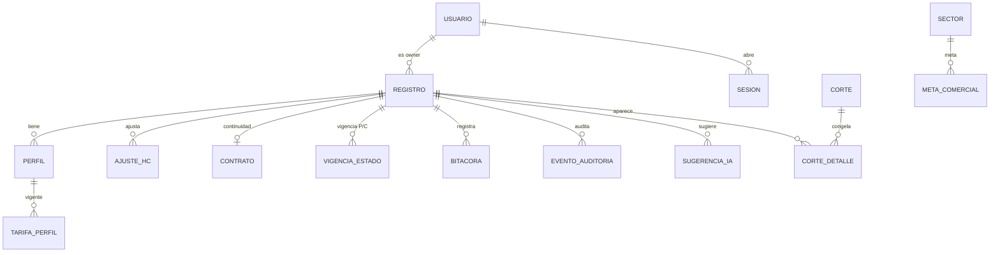

# Data Model: Proyecta — MVP

**Feature**: `001-proyecta-mvp`

**Date**: 2026-10-27

**Spec**: [spec.md](spec.md)

**Plan**: [plan.md](plan.md)

## Overview

El modelo gira alrededor de `Registro`, que representa una oportunidad, demanda o continuidad. Las entidades hijas guardan perfiles, tarifas con vigencia, ajustes de HC, contrato, bitácora, auditoría y sugerencias de IA. `Corte` y `CorteDetalle` congelan los valores mensuales para el cierre y el puente. `ResumenMensual` es una proyección de lectura para el dashboard, no una fuente de verdad.

## Storage Conventions

| Concepto | Representación | Regla |
|---|---|---|
| Dinero CLP | Entero de pesos | Sin decimales; redondeo half-up al final del registro-mes |
| Tarifa por hora | Entero de centavos | Se convierte a `Decimal` al calcular; se muestra con dos decimales |
| Porcentajes | Entero en puntos base (0–10.000) | 10.000 = 100 %; se muestra con coma decimal |
| Fechas de negocio | `date` ISO `YYYY-MM-DD` | Sin hora; un mes se representa por su primer día |
| Eventos | `timestamp` UTC | Se muestran en `America/Santiago` |
| Identificadores | UUID v4 para `id`; claves naturales para unicidad | `Registro.codigo` es la clave natural; `Usuario.email` es único |
| Texto | UTF-8 | Sin límites mayores a los definidos en la spec |

## Entity Catalog

| Entidad | Propósito | Cardinalidad |
|---|---|---|
| `Usuario` | Personas y roles | 1:N con registros como owner |
| `Registro` | Raíz del pipeline | 1:N con perfiles, bitácora, auditoría y vigencias |
| `Perfil` | Rol técnico requerido | N:1 con registro |
| `TarifaPerfil` | Historia de tarifas por perfil | N:1 con perfil |
| `AjusteHC` | Corrección manual de altas/bajas | N:1 con registro |
| `Contrato` | Ficha de una continuidad | 1:1 con registro |
| `VigenciaEstadoCalculo` | Historia mensual de P y C | N:1 con registro |
| `Bitacora` | Seguimiento cronológico inmutable | N:1 con registro |
| `EventoAuditoria` | Cambio trazable por campo | N:1 con registro o entidad |
| `Parametro` | Valores con vigencia (horas, C inicial, umbrales) | N:A |
| `Catalogo` | Sectores, clientes, perfiles, tecnologías, motivos | N:A |
| `MetaComercial` | Objetivo por sector y mes | N:1 con sector |
| `Corte` | Cierre mensual congelado | 1:N con detalles |
| `CorteDetalle` | Valores congelados por registro y mes | N:1 con corte |
| `SugerenciaIA` | Sugerencia con cita y aprobación | N:1 con registro |
| `Sesion` | Sesión de servidor y CSRF | N:1 con usuario |
| `ResumenMensual` | Proyección de lectura del dashboard | N:A (no fuente de verdad) |

## Entities

### Usuario

| Campo | Tipo | Obligatorio | Regla |
|---|---|---|---|
| `id` | UUID | Sí | Clave primaria |
| `nombre` | String(120) | Sí | — |
| `email` | String(254) | Sí | Clave natural; único; minúsculas |
| `rol` | Enum | Sí | `LIDER`, `OPERACIONES`, `EJECUTIVO` |
| `sectores` | Array<String> | No | Sectores asignados para filtros |
| `activo` | Boolean | Sí | Por defecto `true` |
| `password_hash` | String | Sí | Argon2id |
| `intentos_fallidos` | Integer | Sí | Se reinicia al autenticar |
| `bloqueado_hasta` | Timestamp | No | Bloqueo tras cinco intentos |
| `ultimo_acceso` | Timestamp | No | UTC |
| `creado_en`, `actualizado_en` | Timestamp | Sí | UTC |

### Registro

| Campo | Tipo | Obligatorio | Regla |
|---|---|---|---|
| `id` | UUID | Sí | Clave primaria |
| `codigo` | String(12) | Sí | Clave natural `OPD-####`; inmutable |
| `id_externo` | String(50) | No | Único si existe |
| `tipo` | Enum | Sí | `OPORTUNIDAD`, `DEMANDA`, `CONTINUIDAD` |
| `estado` | Enum | Sí | Seis estados; coherencia con tipo y flujo |
| `estado_previo` | Enum | No | Solo para `STANDBY` |
| `flujo` | Enum | Sí | Seis etapas; `PERFILES_SELECCIONADOS` en continuidad |
| `probabilidad_bp` | Integer | Sí | 0–10.000; valor vigente |
| `confiabilidad_bp` | Integer | Sí | 0–10.000; valor vigente |
| `motivo_confiabilidad` | String(300) | Condicional | Obligatorio si cambia la confiabilidad |
| `manager_id` | FK Catálogo | Sí | Gerente de cuenta |
| `owner_id` | FK Usuario | Sí | Líder responsable |
| `sector_id` | FK Catálogo | Sí | Catálogo normalizado |
| `cliente_id` | FK Catálogo | Sí | Catálogo con alias |
| `servicio_proyecto` | String(200) | Sí | — |
| `modalidad` | Enum | Sí | `NTT`, `SUBCONTRATACION` |
| `studio` | Boolean | Sí | Participa un Studio |
| `studio_practica_id` | FK Catálogo | Condicional | Obligatorio si `studio = true` |
| `cuenta` | String(50) | No | Por defecto `No Aplica` |
| `tecnologia_back` | Array<String> | Sí | Al menos un valor o `No Aplica` |
| `tecnologia_front` | Array<String> | Sí | Al menos un valor o `No Aplica` |
| `fecha_creacion` | Date | Sí | No futura |
| `fecha_adjudicacion` | Date | Condicional | Demanda adjudicada o en curso |
| `fecha_cancelacion` | Date | Condicional | Obligatoria si `CANCELADA` |
| `fecha_ingreso` | Date | Condicional | Demanda y continuidad |
| `fecha_fin_vigencia` | Date | No | ≥ `fecha_ingreso` |
| `en_staffing` | Boolean | Sí | Indicador independiente |
| `en_invoicing` | Boolean | Sí | Indicador independiente |
| `observaciones` | Text(2000) | No | No reemplaza la bitácora |
| `motivo_cierre_id` | FK Catálogo | Condicional | Obligatorio si `CERRADA` o `CANCELADA` |
| `fecha_cierre` | Date | Condicional | Obligatoria si `CERRADA` o `CANCELADA` |
| `version` | Integer | Sí | Bloqueo optimista; incrementa en cada edición |
| `creado_por`, `creado_en` | UUID, Timestamp | Sí | UTC |
| `actualizado_por`, `actualizado_en` | UUID, Timestamp | Sí | UTC |

### Perfil

| Campo | Tipo | Obligatorio | Regla |
|---|---|---|---|
| `id` | UUID | Sí | Clave primaria |
| `registro_id` | FK Registro | Sí | Padre |
| `nombre_perfil_id` | FK Catálogo | Sí | Catálogo de perfiles |
| `hc` | Integer | Sí | 1–999 |
| `dedicacion_pct` | Integer | Sí | 1–100; por defecto 100 |
| `fecha_ingreso` | Date | Sí | ≥ `fecha_creacion` del registro |
| `fecha_fin` | Date | No | ≥ `fecha_ingreso`; nula si sigue activo |
| `orden` | Integer | Sí | Orden de presentación |
| `creado_en` | Timestamp | Sí | UTC |

### TarifaPerfil

| Campo | Tipo | Obligatorio | Regla |
|---|---|---|---|
| `id` | UUID | Sí | Clave primaria |
| `perfil_id` | FK Perfil | Sí | Padre |
| `tarifa_hora_centavos` | Integer | Sí | > 0 |
| `vigente_desde` | Date | Sí | Sin superposición con otra tarifa del perfil |
| `vigente_hasta` | Date | No | ≥ `vigente_desde` |
| `motivo_cambio` | String(300) | Condicional | Obligatorio si reemplaza una tarifa |
| `creado_en` | Timestamp | Sí | UTC |

### AjusteHC

| Campo | Tipo | Obligatorio | Regla |
|---|---|---|---|
| `id` | UUID | Sí | Clave primaria |
| `registro_id` | FK Registro | Sí | Padre |
| `mes` | Date | Sí | Primer día de `YYYY-MM` |
| `tipo` | Enum | Sí | `ALTA`, `BAJA` |
| `cantidad` | Integer | Sí | > 0 |
| `motivo` | String(300) | Sí | Explica el ajuste |
| `usuario_id` | FK Usuario | Sí | Solo Operaciones |
| `creado_en` | Timestamp | Sí | UTC |

### Contrato

| Campo | Tipo | Obligatorio | Regla |
|---|---|---|---|
| `registro_id` | FK Registro | Sí | Debe ser `CONTINUIDAD`; clave 1:1 |
| `codigo_contrato` | String(50) | Sí | Único |
| `fecha_inicio` | Date | Sí | ≤ `fecha_fin` |
| `fecha_fin` | Date | Condicional | Obligatoria salvo `es_indefinido` |
| `es_indefinido` | Boolean | Sí | Si es `true`, `fecha_fin` nula |
| `monto_mensual_clp` | Integer | Condicional | ≥ 0; si es nulo, se calcula desde perfiles |
| `hc_comprometido` | Integer | Sí | ≥ 0 |
| `renovacion_automatica` | Boolean | Sí | Por defecto `false` |
| `aviso_termino_dias` | Integer | Sí | Por defecto 90 |
| `estado_contrato` | Enum | Calculado | `VIGENTE`, `POR_VENCER`, `VENCIDO` |
| `observaciones` | Text(1000) | No | — |

### VigenciaEstadoCalculo

| Campo | Tipo | Obligatorio | Regla |
|---|---|---|---|
| `id` | UUID | Sí | Clave primaria |
| `registro_id` | FK Registro | Sí | Padre |
| `campo` | Enum | Sí | `PROBABILIDAD`, `CONFIABILIDAD` |
| `valor_bp` | Integer | Sí | 0–10.000 |
| `vigente_desde` | Date | Sí | Primer día del mes efectivo |
| `motivo` | String(300) | Sí | Motivo del cambio |
| `usuario_id` | FK Usuario | Sí | Operaciones o líder según la regla |
| `creado_en` | Timestamp | Sí | UTC |

### Bitacora

| Campo | Tipo | Obligatorio | Regla |
|---|---|---|---|
| `id` | UUID | Sí | Clave primaria |
| `registro_id` | FK Registro | Sí | Padre |
| `tipo_evento` | Enum | Sí | `SEGUIMIENTO`, `DECISION`, `REUNION`, `ESTADO`, `INCIDENCIA`, `MIGRACION` |
| `contenido` | Text(4000) | Sí | No vacío |
| `proxima_accion` | String(300) | No | Acción comprometida |
| `fecha_compromiso` | Date | Condicional | Obligatoria si hay próxima acción |
| `referencia_id` | FK Bitacora | No | Para correcciones |
| `autor_id` | FK Usuario | Sí | Autor autenticado |
| `creado_en` | Timestamp | Sí | UTC; inmutable |

### EventoAuditoria

| Campo | Tipo | Obligatorio | Regla |
|---|---|---|---|
| `id` | UUID | Sí | Clave primaria |
| `entidad` | Enum | Sí | `REGISTRO`, `PERFIL`, `TARIFA`, `CONTRATO`, `META`, `PARAMETRO`, `USUARIO` |
| `entidad_id` | UUID | Sí | Identificador afectado |
| `registro_id` | FK Registro | No | Presente si la entidad es del pipeline |
| `campo` | String(60) | Sí | Campo modificado |
| `valor_anterior` | JSON | No | Serializado |
| `valor_nuevo` | JSON | No | Serializado |
| `usuario_id` | FK Usuario | Sí | Autor |
| `fecha_hora` | Timestamp | Sí | UTC |
| `motivo` | String(300) | Condicional | Obligatorio según la lista de la spec |
| `fecha_efectiva` | Date | No | Desde cuándo aplica |
| `mab_antes`, `mab_despues` | Integer CLP | No | Impacto mensual |
| `forecast_antes`, `forecast_despues` | Integer CLP | No | Impacto en el horizonte |
| `origen` | Enum | Sí | `UI`, `API`, `CARGA`, `IA`, `MIGRACION` (Principio III) |

### Parametro

| Campo | Tipo | Obligatorio | Regla |
|---|---|---|---|
| `id` | UUID | Sí | Clave primaria |
| `clave` | String(60) | Sí | `horas_mensuales`, `confiabilidad_inicial`, `aviso_termino_dias`, umbrales |
| `valor` | JSON | Sí | Entero, decimal o texto según `tipo` |
| `tipo` | Enum | Sí | `ENTERO`, `DECIMAL`, `TEXTO` |
| `vigente_desde` | Date | Sí | Primer día del mes efectivo |
| `vigente_hasta` | Date | No | ≥ `vigente_desde` |
| `usuario_id` | FK Usuario | Sí | Operaciones |
| `creado_en` | Timestamp | Sí | UTC |

### Catalogo

| Campo | Tipo | Obligatorio | Regla |
|---|---|---|---|
| `id` | UUID | Sí | Clave primaria |
| `tipo` | Enum | Sí | `SECTOR`, `CLIENTE`, `MANAGER`, `PERFIL`, `TECNOLOGIA`, `STUDIO_PRACTICA`, `MOTIVO_CIERRE`, `ALIAS` |
| `codigo` | String(50) | Sí | Único por tipo |
| `etiqueta` | String(150) | Sí | — |
| `orden` | Integer | Sí | — |
| `activo` | Boolean | Sí | Se desactiva, no se borra |
| `metadata` | JSON | No | Alias, equivalencias |
| `padre_id` | FK Catalogo | No | Jerarquía opcional |

### MetaComercial

| Campo | Tipo | Obligatorio | Regla |
|---|---|---|---|
| `id` | UUID | Sí | Clave primaria |
| `sector_id` | FK Catálogo | Sí | Sector |
| `mes` | Date | Sí | Primer día del mes |
| `monto_clp` | Integer | Sí | ≥ 0 |
| `usuario_id` | FK Usuario | Sí | Operaciones |
| `creado_en`, `actualizado_en` | Timestamp | Sí | UTC |

### Corte

| Campo | Tipo | Obligatorio | Regla |
|---|---|---|---|
| `id` | UUID | Sí | Clave primaria |
| `fecha_corte` | Timestamp | Sí | UTC |
| `periodo_referencia` | Date | Sí | Primer día del mes |
| `responsable_id` | FK Usuario | Sí | Operaciones |
| `estado` | Enum | Sí | `CREANDO`, `CERRADO`, `ERROR` |
| `version` | Integer | Sí | Versión del corte |
| `creado_en`, `cerrado_en` | Timestamp | Sí/No | UTC |

### CorteDetalle

| Campo | Tipo | Obligatorio | Regla |
|---|---|---|---|
| `id` | UUID | Sí | Clave primaria |
| `corte_id` | FK Corte | Sí | Padre |
| `registro_id` | FK Registro | Sí | Registro congelado |
| `mes` | Date | Sí | Primer día del mes |
| `bucket` | Enum | Sí | `BACKLOG_CONTRACTUAL`, `MAB` |
| `base_clp` | Integer | Sí | Base del registro-mes |
| `probabilidad_bp` | Integer | Sí | Valor congelado |
| `confiabilidad_bp` | Integer | Sí | Valor congelado |
| `mab_clp` | Integer | Sí | MAB congelada |
| `backlog_clp` | Integer | Sí | Backlog congelado |
| `hc` | Integer | Sí | HC al cierre |

### SugerenciaIA

| Campo | Tipo | Obligatorio | Regla |
|---|---|---|---|
| `id` | UUID | Sí | Clave primaria |
| `registro_id` | FK Registro | Sí | Padre |
| `campo` | String(60) | Sí | Campo sugerido |
| `valor_sugerido` | JSON | Sí | Valor propuesto |
| `cita_bitacora_id` | FK Bitacora | No | Evidencia citada |
| `estado` | Enum | Sí | `PENDIENTE`, `ACEPTADA`, `DESCARTADA` |
| `revisor_id` | FK Usuario | No | Quien acepta o descarta |
| `version_prompt` | String(50) | Sí | Versión del prompt/modelo |
| `creado_en`, `resuelto_en` | Timestamp | Sí/No | UTC |

### Sesion

| Campo | Tipo | Obligatorio | Regla |
|---|---|---|---|
| `id` | String(64) | Sí | Identificador aleatorio; cookie |
| `usuario_id` | FK Usuario | Sí | Dueño |
| `csrf_token` | String(64) | Sí | Token de sincronización |
| `creado_en` | Timestamp | Sí | UTC |
| `expira_en` | Timestamp | Sí | UTC |
| `ip` | String(45) | No | Auditoría de acceso |
| `user_agent` | String(300) | No | Auditoría de acceso |
| `activa` | Boolean | Sí | Revocable |

### ResumenMensual (proyección)

| Campo | Tipo | Obligatorio | Regla |
|---|---|---|---|
| `id` | String | Sí | `periodo:sector:owner:tipo:estado` |
| `periodo` | Date | Sí | Primer día del mes |
| `sector_id` | FK Catálogo | Sí | — |
| `owner_id` | FK Usuario | Sí | — |
| `tipo` | Enum | Sí | — |
| `estado` | Enum | Sí | — |
| `base_clp` | Integer | Sí | Suma de bases |
| `mab_clp` | Integer | Sí | Suma de MAB |
| `backlog_clp` | Integer | Sí | Suma de Backlog contractual |
| `hc` | Integer | Sí | HC al cierre |
| `registros` | Integer | Sí | Conteo |
| `actualizado_en` | Timestamp | Sí | UTC |

## Relationships

## State Machine

| Desde | Hacia | Quién | Condiciones | Efecto |
|---|---|---|---|---|
| Nueva oportunidad | `PENDIENTE` | Líder | Tipo `OPORTUNIDAD` | Flujo 1, P 10 %, C 90 % |
| Nueva demanda directa | `ADJUDICADA` | Líder | Motivo, fecha y al menos un perfil | Tipo `DEMANDA`, P 100 % |
| Nueva continuidad | `EN_CURSO` | Operaciones | Contrato | Flujo 6, P/C 100 % |
| `PENDIENTE` | `ADJUDICADA` | Líder | Fecha y al menos un perfil | Tipo `DEMANDA`, P 100 % |
| `ADJUDICADA` | `EN_CURSO` | Líder | Perfiles con fecha de ingreso | P 100 %, vista de Backlog confirmado |
| Cualquiera no terminal | `STANDBY` | Líder u Operaciones | Motivo | Guarda estado previo, sale del cálculo |
| Cualquiera no terminal | `CERRADA` | Líder u Operaciones | Motivo y fecha | Según el motivo: `TERMINO_SERVICIO` prorratea hasta su fecha; el resto sale desde el mes de cierre |
| Cualquiera no terminal | `CANCELADA` | Líder u Operaciones | Motivo y fecha | Prorratea; `DUPLICADO` sale desde el cierre |
| `STANDBY` | Estado previo | Líder u Operaciones | Motivo de reactivación | Restaura P y C previas |
| `CERRADA`/`CANCELADA` | `PENDIENTE` o `ADJUDICADA` | Operaciones | Motivo de reapertura | Vuelve al pipeline |

## Derived Calculations

| Cálculo | Fórmula | Nota |
|---|---|---|
| `activo(p,m)` | Días activos del perfil en el mes / días del mes | `fin` es el primer día sin actividad |
| `Base(r,m)` | Σ `hc × dedicación × tarifa vigente × horas vigentes × activo` | Decimal; redondeo al final |
| `MAB(r,m)` | `Base × P × C` | Solo bolsa MAB |
| `Backlog contractual(r,m)` | `monto_mensual × activo_contrato`; si no hay monto, Base al 100 % | No se pondera |
| `Backlog confirmado(m)` | Σ `Base × 1 × C` de la MAB con P=100 | Vista, no se suma aparte |
| `Forecast(m)` | `Backlog contractual + MAB` | Una sola bolsa por registro |
| `Ingreso potencial(m)` | Σ Base de la MAB + Backlog contractual | Sin ponderar |
| `HC(r,m)` | Cierre del mes | `Cierre(m-1) + Altas − Bajas` |
| `Tarifa media(r)` | Σ `HC × tarifa` / Σ `HC` | Calculada |
| `Gap(m,s)` | `Meta − Forecast` | Por sector y mes |
| `Cobertura(m,s)` | `Forecast / Meta` si `Meta > 0` | Porcentaje |

## Invariants & Validations

- `Registro.codigo` y `Usuario.email` son únicos; el código es inmutable.
- `probabilidad_bp` y `confiabilidad_bp` están entre 0 y 10.000; `P` se fija en 100 % en `ADJUDICADA`, `PERFILES_SELECCIONADOS`, `EN_CURSO` y `CONTINUIDAD`.
- `hc` es entero 1–999; `dedicacion_pct` 1–100; `tarifa_hora_centavos > 0`.
- Las tarifas de un mismo perfil no se superponen; un cambio no reescribe meses anteriores.
- Cada registro pertenece a una sola bolsa por mes; `Forecast = Backlog contractual + MAB`.
- Un registro `CONTINUIDAD` tiene exactamente un contrato; oportunidad y demanda no tienen contrato.
- Una meta es única por sector y mes; `monto_clp ≥ 0`.
- `CorteDetalle` no existe sin `Corte`; un `Corte` `CERRADO` es inmutable.
- No hay borrado físico de registros, perfiles, contratos, metas, cortes, bitácoras ni eventos.
- Toda edición exige la versión leída; el conflicto se informa y no se pierde lo escrito.
- Las fechas respetan el orden: creación ≤ adjudicación/cancelación/cierre; ingreso ≤ fin de vigencia; inicio ≤ fin del contrato.
- Las horas mensuales son un parámetro con vigencia; cada mes usa el valor vigente y no se reescribe el pasado.
- La probabilidad y la confiabilidad se resuelven por mes desde `VigenciaEstadoCalculo`.

## Indexes & Access Patterns

| Entidad | Índice / clave | Uso |
|---|---|---|
| `Registro` | `owner_id + estado` | Bandeja del líder |
| `Registro` | `sector_id + estado` | Dashboard por sector |
| `Registro` | `tipo + estado + fecha_ingreso` | Próximos ingresos |
| `Registro` | `codigo` (clave) | Búsqueda por código |
| `Perfil` | `registro_id` | Ficha del registro |
| `TarifaPerfil` | `perfil_id + vigente_desde` | Tarifa vigente |
| `AjusteHC` | `registro_id + mes` | Grilla mensual |
| `Bitacora` | `registro_id + creado_en` | Cronología |
| `EventoAuditoria` | `registro_id + fecha_hora` | Auditoría por registro |
| `EventoAuditoria` | `usuario_id + fecha_hora` | Auditoría por usuario |
| `VigenciaEstadoCalculo` | `registro_id + campo + vigente_desde` | Resolver P/C por mes |
| `Parametro` | `clave + vigente_desde` | Horas y umbrales |
| `MetaComercial` | `sector_id + mes` | Gap |
| `CorteDetalle` | `corte_id + mes` | Puente y reportes |
| `SugerenciaIA` | `registro_id + estado` | Bandeja de sugerencias |
| `ResumenMensual` | `periodo + sector_id` | Dashboard |

## Audit & Immutability

- Cada cambio auditado genera un `EventoAuditoria` por campo, con valor anterior, valor nuevo, usuario, fecha/hora UTC, origen, fecha efectiva, motivo cuando corresponda e impacto en MAB/Forecast.
- `Bitacora` y `EventoAuditoria` no tienen métodos de actualización ni borrado en el repositorio; los routers no exponen `PUT`/`DELETE`.
- Una corrección es una entrada nueva que referencia la anterior.
- El cierre escribe `CorteDetalle` en lotes y marca `Corte.estado = CERRADO` solo al completar; una corrección genera una nueva versión del corte.
- La retención es de al menos cinco años para auditoría y datos de negocio; no se configura TTL que elimine antes.

## Data Volume & Retention

| Dato | Volumen estimado | Retención |
|---|---|---|
| Registros | 5.000 | Activo + 5 años |
| Perfiles / tarifas | 15.000 / 20.000 | Activo + 5 años |
| Cortes y detalles | 12 cortes/año × 60.000 filas | 5 años |
| Eventos de auditoría | ~500.000 en 5 años | 5 años |
| Sesiones | 50 concurrentes | Expiración corta; no se retienen |
| Semilla sintética | 1.000 registros | Solo dev/demo |

## Mapping to Functional Requirements

| Grupo | Entidades |
|---|---|
| `FR-001` a `FR-010` | `Registro`, `Catalogo`, `Usuario` |
| `FR-011` a `FR-017` | `Perfil`, `TarifaPerfil`, `AjusteHC` |
| `FR-018` a `FR-028` | `Registro`, `VigenciaEstadoCalculo`, `Catalogo` |
| `FR-029` a `FR-038` | `Registro`, `Perfil`, `TarifaPerfil`, `Parametro`, `Contrato` |
| `FR-039` a `FR-045` | `Contrato`, `MetaComercial` |
| `FR-046` a `FR-052` | `ResumenMensual`, `CorteDetalle`, `Registro` |
| `FR-053` a `FR-060` | `Bitacora`, `EventoAuditoria` |
| `FR-061` a `FR-067` | `Usuario`, `Sesion` |
| `FR-068` a `FR-072` | `Registro`, `Perfil`, `Contrato`, `MetaComercial` |
| `FR-073` a `FR-077` | `Corte`, `CorteDetalle` |
| `FR-078` a `FR-081` | `Registro`, `EventoAuditoria` (exportación) |
| `FR-082` a `FR-086` | `SugerenciaIA`, `Registro` |
| `FR-087` a `FR-090` | `Registro`, `Perfil`, `AjusteHC` (carga sintética) |
